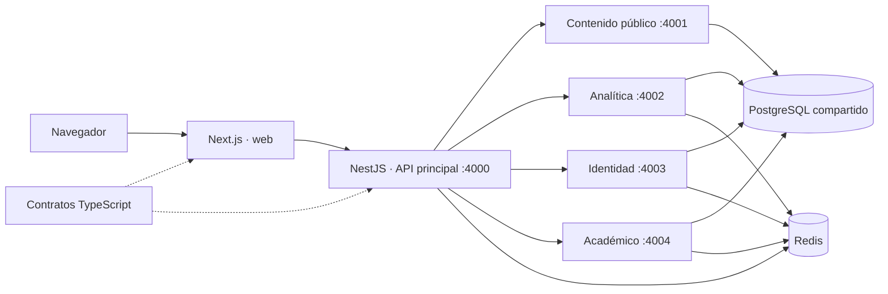
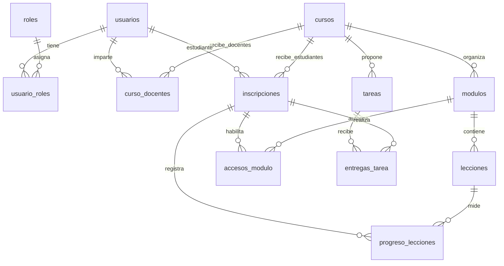
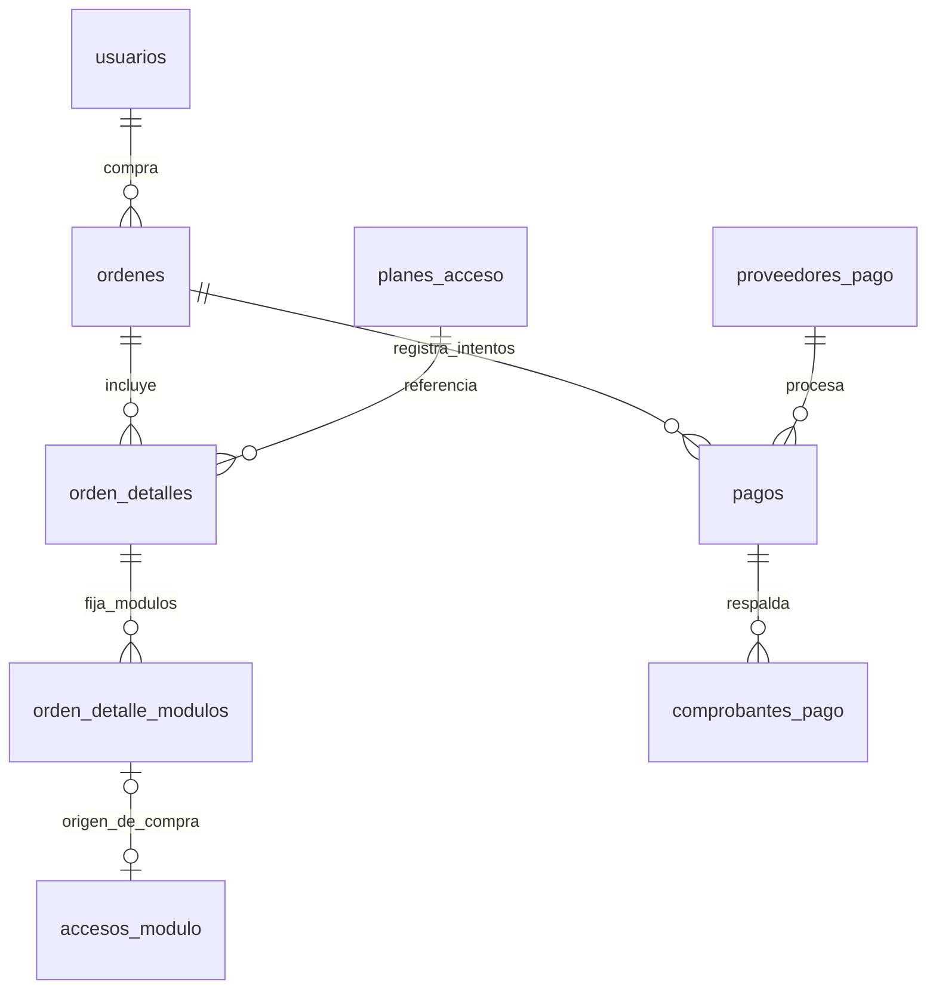
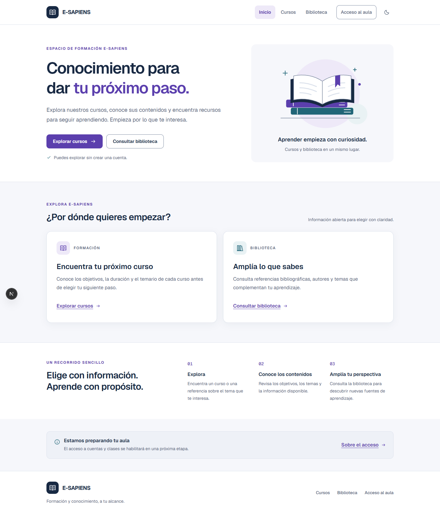
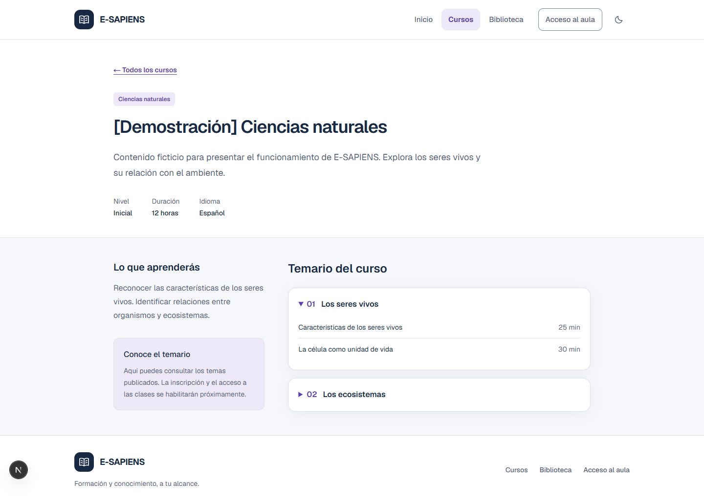

# E-SAPIENS

Plataforma educativa web para consultar materias y bibliografía, gestionar cuentas e inscripciones, organizar la docencia y acompañar el progreso de los estudiantes. Proyecto académico de Tecnologías Web II, organizado como monorepo TypeScript con frontend y API independientes.

Este README concentra la instalación, arquitectura, operación, demostración y mantenimiento del proyecto. La rama de integración es [`develop`](https://github.com/KevinTapiaAli/E-SAPIENS/tree/develop).

## Contenido

- [Dos espacios de trabajo](#dos-espacios-de-trabajo)
- [Evolución LMS: pagos, evaluaciones e identidad](#evolución-lms-pagos-evaluaciones-e-identidad)
- [Guía rápida para defender el proyecto](#guía-rápida-para-defender-el-proyecto)
- [Estado del avance y presentación](#estado-del-avance-y-presentación)
- [Funciones por perfil](#funciones-por-perfil)
- [Tecnologías y decisiones](#tecnologías-y-decisiones)
- [Estructura del código](#estructura-del-código)
- [Servicios independientes](#servicios-independientes)
- [Instalación en otra computadora](#instalación-en-otra-computadora)
- [Usar Swagger y OpenAPI](#usar-swagger-y-openapi)
- [Mapa de la API REST](#mapa-de-la-api-rest)
- [Recorrido para revisar el sistema](#recorrido-para-revisar-el-sistema)
- [Configuración](#configuración)
- [Despliegue de la web y los servicios](#despliegue-de-la-web-y-los-servicios)
- [Comandos disponibles](#comandos-disponibles)
- [Actualizar después de un cambio](#actualizar-después-de-un-cambio)
- [Base de datos y seguridad](#base-de-datos-y-seguridad)
- [Cómo explicar la relación entre estudiantes, docentes y pagos](#cómo-explicar-la-relación-entre-estudiantes-docentes-y-pagos)
- [Indicadores ejecutivos](#indicadores-ejecutivos)
- [Capturas de ejecución](#capturas-de-ejecución)
- [Problemas frecuentes](#problemas-frecuentes)
- [Calidad y alcance](#calidad-y-alcance)

## Guía rápida para defender el proyecto

### Presentación en un minuto

> E-SAPIENS es una plataforma educativa desarrollada como avance de Tecnologías Web II. Next.js presenta la interfaz y NestJS implementa la API. Tenemos acceso por perfiles de administración, docente y estudiante. La API comprueba sesiones, permisos y la relación del usuario con cada materia. Separamos el catálogo y la biblioteca en un servicio de contenido, y las visitas e indicadores en un servicio de analítica. Los cinco procesos del backend se comunican por HTTP y comparten PostgreSQL en esta etapa. Swagger documenta y permite consultar las APIs; no sustituye los controles de seguridad. El marketplace registra órdenes y referencias de transferencia o QR, y un administrador verifica el ingreso bancario antes de habilitar el acceso. Los cobros automáticos siguen pendientes.

### Autorizar el Swagger que aparece en pantalla

En esta computadora, la API principal está configurada en **http://localhost:4100/api/docs** porque el puerto 4000 está ocupado por otro proyecto. Los ejemplos generales del README conservan el puerto predeterminado 4000. La web local está en http://localhost:3000.

| Interfaz                                   | Cómo autenticarte                                                                                                                       | Cómo confirmar el acceso                                                                      |
| ------------------------------------------ | --------------------------------------------------------------------------------------------------------------------------------------- | --------------------------------------------------------------------------------------------- |
| Principal, puerto 4100 en esta instalación | **Identity → POST /api/v1/identity/login → Try it out**. Introducir tu correo y contraseña de una cuenta aprobada y pulsar **Execute**. | Login `200`; después `GET /api/v1/identity/me` debe devolver tu identidad, roles y permisos.  |
| Contenido, http://127.0.0.1:4001/api/docs  | **Authorize → internal-service**: introducir el valor de `INTERNAL_SERVICE_TOKEN` del `.env` local, sin `Bearer` ni comillas.           | `GET /api/v1/courses` devuelve contenido; sin clave devuelve `401`.                           |
| Analítica, http://127.0.0.1:4002/api/docs  | Autorizar por separado con la misma clave interna de esta instalación.                                                                  | `GET /api/v1/analytics/dashboard?days=30` devuelve los indicadores; sin clave devuelve `401`. |

En Swagger principal **no pegues contraseñas en Authorize**: se usa una cookie `HttpOnly` que el navegador recibe al iniciar sesión y envía automáticamente. El candado representa el requisito de seguridad; no es un indicador fiable de que la sesión esté activa. La comprobación es `identity/me`. Los correos de ejemplo no son cuentas creadas ni tienen contraseña predeterminada.

Para demostrar seguridad: consulta `identity/me` sin sesión (`401`), inicia sesión con una cuenta aprobada (`200`), consulta sus permisos y termina con `POST /identity/logout`. Al repetir `identity/me`, debe responder `401`. Una cuenta de estudiante no puede consultar el panel administrativo: recibe `403`. Usa **Try it out** solo cuando quieras ejecutar realmente una operación; los `POST` pueden modificar la base. No proyectes la contraseña, la cookie ni la clave interna al público.

Si el login responde `403 ORIGIN_NOT_ALLOWED`, abre exactamente `http://localhost:4100` y confirma que `.env` contiene `SWAGGER_ORIGIN=http://localhost:4100`, mientras `APP_URL` sigue siendo `http://localhost:3000`. Si cambias esas variables, debes reiniciar la API. `401` en login indica credenciales incorrectas; `403` también puede indicar cuenta pendiente/suspendida. `503` requiere revisar disponibilidad de API, PostgreSQL o Redis, no cambiar la contraseña.

### Explicación y demostración de microservicios

> Tenemos un gateway y cuatro servicios HTTP: identidad, académico, contenido y analítica. Cada servicio tiene su proceso y puerto; el gateway no abre conexiones SQL. Las llamadas internas llevan una clave privada y las rutas privadas mantienen sus controles de sesión y permisos. PostgreSQL sigue compartido: la independencia de ejecución no implica independencia de datos.

| Proceso                 | Qué hace                                                                   | Qué mostrar durante la defensa                                                                                                       |
| ----------------------- | -------------------------------------------------------------------------- | ------------------------------------------------------------------------------------------------------------------------------------ |
| API principal / gateway | Sesiones, permisos, administración, docencia, aula y llamadas a servicios. | Login, `identity/me` y una consulta de materias de tu perfil.                                                                        |
| Contenido               | Lecturas públicas de cursos, temarios y biblioteca.                        | Consultar `/api/v1/courses` en Swagger principal y en Swagger de contenido autorizado: proceden del mismo servicio y datos.          |
| Analítica               | Registra visitas y calcula indicadores.                                    | En Swagger principal, consultar `/api/v1/analytics/dashboard` como administrador; en el interno, autorizar con la clave de servicio. |

Para mostrar separación, abre los documentos Swagger y sus archivos de entrada. No necesitas detener servicios durante la exposición. `GET /api/v1/health/ready` de la API principal permite mostrar si identidad, académico, contenido, analítica y Redis están disponibles. La documentación por sí sola no prueba un despliegue distribuido: explica también la llamada HTTP del gateway.

**Ventajas actuales:** responsabilidades separadas y posibilidad de ejecutar cada backend por separado. **Límites actuales:** mismo repositorio, compilación y base de datos; no hay colas, bases por servicio ni escalado automático implementado. La clave interna autentica procesos de confianza; los roles de usuario se verifican en la API principal antes de delegar. Por eso la clave de servicios no se entrega a estudiantes ni se publica en el frontend.

### Código que puedes abrir durante la defensa

Las líneas son referencias de esta revisión y pueden moverse con futuras ediciones.

| Tema                  | Archivo y línea de inicio                                                                                                                                                      | Qué explicar                                                               |
| --------------------- | ------------------------------------------------------------------------------------------------------------------------------------------------------------------------------ | -------------------------------------------------------------------------- |
| Composición principal | [app.module.ts](apps/api/src/app.module.ts#L8), línea 8                                                                                                                        | Reúne identidad, académico, salud y gateway.                               |
| Entrada de contenido  | [content-main.ts](apps/api/src/content-main.ts#L4), línea 4                                                                                                                    | Inicia el proceso de contenido en 4001.                                    |
| Entrada de analítica  | [analytics-main.ts](apps/api/src/analytics-main.ts#L4), línea 4                                                                                                                | Inicia el proceso de analítica en 4002.                                    |
| Módulos internos      | [content.module.ts](apps/api/src/services/content.module.ts#L10), línea 10; [analytics.module.ts](apps/api/src/services/analytics.module.ts#L71), línea 71                     | Dependencias, controladores y guard de cada servicio.                      |
| Arranque compartido   | [bootstrap.ts](apps/api/src/services/bootstrap.ts#L8), línea 8                                                                                                                 | Validación HTTP, escucha y Swagger interno solo fuera de producción.       |
| Gateway               | [gateway.module.ts](apps/api/src/infrastructure/services/gateway.module.ts#L17), línea 17                                                                                      | Sustituye proveedores de negocio por clientes remotos.                     |
| Llamada HTTP          | [service-client.ts](apps/api/src/infrastructure/services/service-client.ts#L14), línea 14                                                                                      | Clave interna, timeout de ocho segundos, destinos seguros y errores `503`. |
| Seguridad interna     | [internal-security.ts](apps/api/src/services/internal-security.ts#L12), línea 12                                                                                               | Exige y compara la clave antes de permitir el endpoint.                    |
| Lógica real           | [catalog.service.ts](apps/api/src/modules/catalog/catalog.service.ts#L19), línea 19; [analytics.service.ts](apps/api/src/modules/analytics/analytics.service.ts#L35), línea 35 | Consulta de cursos y cálculo de indicadores en PostgreSQL.                 |
| Swagger principal     | [swagger.ts](apps/api/src/common/http/swagger.ts#L5), línea 5                                                                                                                  | Documento OpenAPI, cookie, instrucciones y respuestas de acceso.           |
| Sesión y permisos     | [identity.service.ts](apps/api/src/modules/identity/identity.service.ts#L94), líneas 94 y 152                                                                                  | Autentica la sesión y autoriza rol/permiso.                                |
| Origen permitido      | [identity-security.service.ts](apps/api/src/modules/identity/identity-security.service.ts#L49), líneas 49 y 72                                                                 | Swagger local explícito y protección del origen de las escrituras.         |

### Respuestas cortas a preguntas habituales

| Pregunta                             | Respuesta                                                                                                                                                                                                                                                           |
| ------------------------------------ | ------------------------------------------------------------------------------------------------------------------------------------------------------------------------------------------------------------------------------------------------------------------- |
| ¿Swagger es otro microservicio?      | No. Es la interfaz de documentación OpenAPI de cada API. Describe rutas, cuerpos, respuestas y mecanismos de autenticación.                                                                                                                                         |
| ¿Usan JWT?                           | No. Usamos sesiones opacas y revocables, con cookie `HttpOnly`; las contraseñas se protegen mediante Argon2id.                                                                                                                                                      |
| ¿Ocultar un botón impide el acceso?  | No. La API comprueba la sesión y permisos en cada operación, aunque se invoque desde Swagger.                                                                                                                                                                       |
| ¿Cada servicio tiene su base?        | No en esta etapa. Los procesos son independientes, pero comparten PostgreSQL y sus migraciones.                                                                                                                                                                     |
| ¿Estar matriculado da acceso a todo? | No. También se comprueban autorizaciones de módulos, vigencia, estado y progresión cuando corresponda.                                                                                                                                                              |
| ¿Ya se puede pagar desde la web?     | La web registra órdenes y referencias de transferencia/QR. El pago se realiza mediante el banco y administración verifica el ingreso antes de habilitar el acceso. Requiere configurar las instrucciones institucionales; no existe cobro automático ni blockchain. |

## Estado del avance y presentación

E-SAPIENS es una **versión académica en desarrollo** con catálogo público, identidad, tres portales, gestión académica y cuatro servicios internos. Las funciones descritas a continuación están implementadas; requieren una instalación configurada, cuentas aprobadas y servicios disponibles. Este repositorio no contiene contraseñas de usuarios ni sustituye la preparación de la base de datos.

| Área                               | Avance implementado                                                                                                                                                              | Dónde revisarlo                                                    |
| ---------------------------------- | -------------------------------------------------------------------------------------------------------------------------------------------------------------------------------- | ------------------------------------------------------------------ |
| Web pública                        | Inicio, materias publicadas, temarios, biblioteca, registro y acceso.                                                                                                            | `/`, `/cursos`, `/biblioteca`, `/registro`, `/login`               |
| Identidad                          | Sesiones revocables, aprobación de cuentas, roles, permisos y foto de perfil.                                                                                                    | `apps/api/src/modules/identity/`                                   |
| Administración, docencia y estudio | Materias, asignaciones, inscripciones, acceso a módulos, lecciones, tareas, entregas, calificaciones, avance y agenda.                                                           | `/portal` y `apps/api/src/modules/academic/`                       |
| Microservicios                     | Identidad, académico, contenido y analítica por HTTP autenticado; gateway sin SQL.                                                                                               | `apps/api/src/services/` y `apps/api/src/infrastructure/services/` |
| Documentación de API               | Tres interfaces Swagger, esquemas, ejemplos, autenticación por cookie o clave interna y errores de acceso.                                                                       | [Swagger y OpenAPI](#usar-swagger-y-openapi)                       |
| Renderizado privado                | `/login` y las consultas privadas esperan una solicitud real mediante `connection()`; no consultan sesiones al compilar.                                                         | `apps/web/src/features/auth/server.ts`                             |
| Mantenimiento                      | Migraciones, semillas opcionales, pruebas y Quality Gate. Retirados el módulo monolítico de analítica sin uso y las variables de integraciones no implementadas de la plantilla. | `database/`, `scripts/`, `.github/workflows/ci.yml`                |

**Preparación de la presentación:** seguir la instalación, ejecutar `setup:demo`, disponer de una cuenta aprobada por perfil e iniciar `pnpm.cmd dev`. Usar el recorrido de este README para preparar una materia asignada, una matrícula con módulos autorizados y una tarea. Estos datos académicos no se crean automáticamente al clonar. Mantener las contraseñas y la clave interna fuera de diapositivas y capturas.

**Recorrido sugerido de 10 minutos:** portada y catálogo (2 min), administración y asignación (2 min), docente con tarea (2 min), estudiante con acceso y entrega (2 min), Swagger y arquitectura de servicios (2 min). El panel muestra actividad de esa base; un indicador sin actividad no se rellena con cifras inventadas.

## Funciones por perfil

| Perfil         | Funciones implementadas                                                                                                                                   |
| -------------- | --------------------------------------------------------------------------------------------------------------------------------------------------------- |
| Visitante      | Inicio institucional, muestra de materias publicadas, catálogo con búsqueda y paginación, temarios, fichas bibliográficas y solicitud de cuenta.          |
| Estudiante     | Materias inscritas, solicitudes de inscripción, lecciones autorizadas, avance, materiales, tareas, entregas, cárdex y calendario personal.                |
| Docente        | Materias asignadas, materiales, tareas, revisión de entregas, calificaciones, solicitudes de inscripción y seguimiento de estudiantes.                    |
| Administración | Panel ejecutivo, gestión de personas y materias, revisión de formación docente, asignaciones, matrículas, autorizaciones por módulo y análisis académico. |

Los tres espacios comparten navegación con búsqueda, accesos móviles, ayuda contextual, preferencias y calendario lateral. La agenda permanece cerrada hasta abrirla, permite cambiar de mes y muestra próximos pendientes. El carrusel institucional cambia cada cinco segundos y ofrece controles de pausa. Las opciones visibles dependen de los permisos; la API vuelve a comprobar la autorización en cada operación.

## Tecnologías y decisiones

Las versiones exactas de dependencias están fijadas en `pnpm-lock.yaml`; no es necesario instalar NestJS ni Next.js globalmente.

| Tecnología                                 | Uso y motivo                                                                                                                                      |
| ------------------------------------------ | ------------------------------------------------------------------------------------------------------------------------------------------------- |
| Node.js 24                                 | Entorno común de ejecución; `.node-version` fija la referencia 24.21.0 para desarrollo y CI.                                                      |
| TypeScript                                 | Contratos explícitos y comprobación estática entre capas.                                                                                         |
| Next.js 16 + React 19                      | Renderizado en servidor del catálogo y composición de interfaces privadas; componentes cliente únicamente para interacciones.                     |
| Tailwind CSS 4 + CSS Modules               | Estilos compartidos, temas y componentes aislados sin una biblioteca adicional de interfaz. Las fuentes del sistema evitan descargas al compilar. |
| NestJS 12                                  | API modular con inyección de dependencias, DTO, validación y autorización centralizada.                                                           |
| PostgreSQL 18 + `pg`                       | Integridad relacional, transacciones, funciones de acceso y consultas SQL parametrizadas. Se conserva el modelo SQL sin añadir un ORM.            |
| Redis 7.4                                  | Límites compartidos de autenticación y medición entre instancias. El acceso se bloquea si no puede aplicarse su protección.                       |
| pnpm 10.34.5 + Turborepo                   | Dependencias de workspace, lockfile único y coordinación de tareas de web/API.                                                                    |
| Docker Compose                             | PostgreSQL y Redis reproducibles para desarrollo, con volumen persistente y comprobaciones de disponibilidad.                                     |
| OpenAPI / Swagger                          | Documentación interactiva generada desde la API.                                                                                                  |
| Argon2id, Helmet y Pino                    | Hash de contraseñas, cabeceras de protección y registros estructurados con ocultación de secretos.                                                |
| Jest, Supertest, ESLint, Oxlint y Prettier | Infraestructura de calidad y estilo del repositorio. GitHub Actions ejecuta el flujo de integración.                                              |

Se utiliza una **arquitectura de servicios HTTP con gateway y base compartida**. Identidad, gestión académica, contenido público y analítica se ejecutan en cuatro procesos NestJS independientes. Next.js conserva las rutas existentes. El gateway delega identidad y académico, preservando cookies, cuerpos, estados HTTP y origen; cada servicio aplica sus validaciones. Todavía se comparten esquema SQL, proveedores de autorización y compilación. No es una arquitectura con propiedad exclusiva de datos por servicio.



## Estructura del código

```text
apps/
  web/src/
    app/                 Rutas públicas, portales y proxies de Next.js
    features/            Catálogo, autenticación, aula, docencia y analítica
    shared/              Componentes visuales y clientes HTTP
  api/src/
    modules/             Identidad, académico, catálogo, biblioteca y analítica
    infrastructure/      Conexiones con PostgreSQL y Redis
    services/            Arranque y rutas internas de los cuatro servicios
    common/              Validación HTTP y tratamiento de errores
    cli/                 Creación autorizada de cuentas
  api/test/              Pruebas de integración
packages/contracts/      Tipos compartidos entre web y API
database/
  migrations/            Esquema inicial y migraciones incrementales
  seeds/                 Contenido ficticio opcional para demostración
scripts/                 Preparación local, migraciones y retención analítica
assets/screenshots/      Capturas históricas incorporadas a este README
.github/workflows/       Integración continua
```

Las lecturas privadas no se almacenan en cachés públicas. Las consultas se paginan y utilizan conexiones acotadas. La agenda y las actividades complementarias cargan a demanda. La muestra de cursos de la portada utiliza la misma API y tarjetas que el catálogo, con un máximo de tres materias y estados diferenciados para carga, ausencia de datos y servicio no disponible.

## Servicios independientes

Cada dominio tiene un proceso. Pagos, matrículas y aula permanecen dentro del dominio académico para conservar la confirmación de pago y la habilitación del acceso en una transacción SQL.

| Proceso           | Puerto local | Responsabilidad                                                                                                                                                     | Entrada                          |
| ----------------- | ------------ | ------------------------------------------------------------------------------------------------------------------------------------------------------------------- | -------------------------------- |
| Gateway           | 4000 o 4100  | Entrada pública, enrutamiento, documentación agregada y autorización de analítica; sin pool SQL.                                                                    | `apps/api/src/main.ts`           |
| Identidad         | 4003         | Inicio/cierre de sesión, registro, perfil, cuentas y sesiones revocables.                                                                                           | `apps/api/src/identity-main.ts`  |
| Académico         | 4004         | Materias, matrículas, tareas, evaluaciones, progreso, agenda, pagos y revisión administrativa.                                                                      | `apps/api/src/academic-main.ts`  |
| Contenido público | 4001         | Consulta de materias publicadas, temarios y biblioteca pública. Las modificaciones siguen en la API académica.                                                      | `apps/api/src/content-main.ts`   |
| Analítica         | 4002         | Registro de visitas y cálculo del panel ejecutivo. La API principal comprueba la sesión, los permisos, el origen y las preferencias de privacidad antes de delegar. | `apps/api/src/analytics-main.ts` |

Los módulos de arranque están en `apps/api/src/services/`. Los clientes HTTP y la configuración de rutas de la API principal están en `apps/api/src/infrastructure/services/`. `common/runtime.module.ts` comparte configuración, registros y manejo de errores, sin arrancar otros procesos.

### Arranque y configuración

Después de instalar dependencias, `pnpm.cmd dev` prepara el entorno y arranca la web y los cinco procesos de backend en la misma terminal. `Ctrl+C` detiene los procesos supervisados. El supervisor es `scripts/start-backends.mjs`; no crea servicios permanentes del sistema operativo. Si ya estaba ejecutándose, detenerlo y volver a iniciarlo para incorporar identidad y académico.

`setup:demo` continúa preparando solamente infraestructura y datos. Ambos comandos generan una clave aleatoria `INTERNAL_SERVICE_TOKEN` en `.env` cuando falta, sin imprimirla ni subirla a Git. Las instalaciones existentes también reciben esta clave al ejecutar el preparador. Las URLs omitidas usan los valores locales de la tabla siguiente.

| Variable                                          | Valor local / función                                                                         |
| ------------------------------------------------- | --------------------------------------------------------------------------------------------- |
| `CONTENT_SERVICE_URL`                             | `http://127.0.0.1:4001`; destino de las consultas públicas.                                   |
| `ANALYTICS_SERVICE_URL`                           | `http://127.0.0.1:4002`; destino de la analítica.                                             |
| `IDENTITY_SERVICE_URL` / `IDENTITY_SERVICE_PORT`  | `http://127.0.0.1:4003` / `4003`; sesiones y cuentas.                                         |
| `ACADEMIC_SERVICE_URL` / `ACADEMIC_SERVICE_PORT`  | `http://127.0.0.1:4004` / `4004`; gestión académica y pagos.                                  |
| `CONTENT_SERVICE_PORT` / `ANALYTICS_SERVICE_PORT` | `4001` / `4002`; puertos de escucha de cada servicio.                                         |
| `INTERNAL_SERVICE_TOKEN`                          | Secreto compartido de al menos 32 caracteres, generado automáticamente para desarrollo local. |
| `SERVICE_BIND_HOST`                               | `127.0.0.1`; los cuatro servicios internos escuchan solo en la máquina local por defecto.     |

Para ejecutar cada backend por separado, preparar primero el entorno y abrir una terminal por comando, desde la raíz:

```powershell
pnpm.cmd --dir apps/api dev:content
pnpm.cmd --dir apps/api dev:analytics
pnpm.cmd --dir apps/api dev:identity
pnpm.cmd --dir apps/api dev:academic
pnpm.cmd --dir apps/api dev:core
```

Cada comando ocupa su terminal. No combinarlos con `pnpm.cmd dev`, que ya inicia todos. Compilar con `pnpm.cmd --dir apps/api build`. En producción se pueden ejecutar por separado `start:content`, `start:analytics`, `start:identity`, `start:academic` y `start:prod`; `start:services` supervisa el conjunto. Para escalar o reiniciar cada dominio de forma independiente, usar las unidades systemd indicadas abajo o el supervisor del proveedor. Producción requiere `APP_URL` con HTTPS y las URLs internas configuradas.

### Decisiones de eficiencia y alcance

- **NestJS + TypeScript + HTTP:** se reutilizan DTO, contratos, validación y librerías existentes. No se añade un broker sin un trabajo asíncrono que lo necesite. Cada servicio tiene un punto de entrada y puede tener sus propias réplicas.
- **PostgreSQL + pg:** se conservan transacciones e índices existentes. Con `DATABASE_POOL_MAX=10`, cuatro procesos con base pueden abrir hasta 40 conexiones por conjunto; las réplicas multiplican ese límite. El gateway usa cero conexiones SQL. Dimensionar con margen para migraciones y administración; aumentar conexiones no garantiza más rendimiento ([documentación PostgreSQL](https://www.postgresql.org/docs/current/runtime-config-connection.html)).
- **Redis + ioredis:** se reutilizan conexiones por proceso para límites distribuidos de solicitudes. Si Redis falla, el acceso falla de forma segura. No se almacenan permisos ni sesiones en una caché que retrase su revocación ([conexiones Redis](https://redis.io/docs/latest/develop/clients/pools-and-muxing/)).
- **Transporte:** timeout de ocho segundos, sin seguir redirecciones ni reintentar escrituras automáticamente; errores de negocio y cookies se conservan. El token interno del navegador se descarta y el gateway añade el suyo.
- **Swagger:** el gateway agrega las especificaciones reales de identidad y académico mediante `/internal/openapi`, protegido por clave interna. Conserva `/api/docs` y `/api/docs-json`; si esos servicios no están disponibles, el JSON responde 503. Solo la documentación se reutiliza durante 60 segundos, nunca datos de usuario.
- **Límites:** base y credenciales SQL compartidas, gestión de usuarios también utilizada por administración académica y compilación común. Separar bases requiere migrar relaciones, auditoría y transacciones; no se simula esa independencia. No se midió capacidad para una ciudad ni se promete disponibilidad total sin pruebas de carga e infraestructura.

Swagger interno de identidad: `http://127.0.0.1:4003/api/docs`; académico: `http://127.0.0.1:4004/api/docs`. Solo se habilitan en desarrollo. Las rutas privadas exigen **clave interna y cookie de sesión**, no una u otra. Para demostraciones de usuarios, iniciar sesión desde el Swagger del gateway autorizado por `SWAGGER_ORIGIN`; no copiar cookies HttpOnly ni publicar la clave interna. Los hostnames `localhost` y `127.0.0.1` no comparten cookies.

### Comunicación, seguridad y límites de esta etapa

- La web conserva `API_URL=http://localhost:4000` y las rutas `/api/v1/courses`, `/api/v1/library` y `/api/v1/analytics`. Swagger público permanece en `http://localhost:4000/api/docs`.
- Los servicios internos exigen la cabecera privada `x-internal-service-token`, incluso en su ruta de disponibilidad. Esa clave se mantiene en el servidor, se oculta en los registros y no se incluye en la web ni en los documentos OpenAPI. Para usar Swagger interno local, el operador debe introducirla manualmente. No hay rutas de login ni administración en los dos servicios nuevos.
- El cliente HTTP aplica un límite de ocho segundos, no sigue redirecciones ni reintenta escrituras automáticamente. Las conexiones remotas requieren HTTPS. Un servicio caído produce `503` en sus operaciones, sin ejecutar silenciosamente la lógica en la API principal.
- `GET /api/v1/health/ready` en el puerto 4000 incluye Redis y los cuatro servicios, que comprueban sus dependencias. Devuelve `503` si alguna dependencia no está lista. Esperar a que los cinco procesos indiquen que arrancaron antes de usar el sistema.
- PostgreSQL y sus migraciones siguen siendo compartidos: las escrituras académicas pertenecen al núcleo, el contenido público realiza lecturas y analítica registra visitas y lee los indicadores. No se duplican cuentas ni se trasladan datos. Cada proceso utiliza un pool de hasta 10 conexiones; dimensionar PostgreSQL para el conjunto de procesos y réplicas.
- Los servicios se pueden ejecutar y desplegar por separado utilizando el mismo artefacto compilado. Esta entrega comparte código, esquema y credenciales de base de datos; el aislamiento de datos por servicio, usuarios SQL específicos, colas y despliegue distribuido quedan como trabajo posterior.
- Las pruebas unitarias de transporte y autenticación interna simulan HTTP sin abrir servidores. Las pruebas de catálogo importan `RuntimeModule`, `CatalogModule` y `LibraryModule` directamente y conservan el override de `DatabaseService` para su transacción aislada; no dependen de `GatewayModule`. La suite de salud simula los servicios internos. Estas comprobaciones no equivalen a una prueba distribuida completa.

## Instalación en otra computadora

### 1. Requisitos

- Git.
- Node.js **24.21.0**, conforme a `.node-version`.
- Docker Desktop iniciado, con motor de contenedores Linux listo. En Windows, habilitar su integración con WSL 2.
- Internet durante la descarga inicial del repositorio, dependencias e imágenes Docker.
- Puertos locales 3000, 4000, 4001, 4002, 4003, 4004, 5433 y 6379 disponibles.

Los ejemplos usan PowerShell. El sufijo `.cmd` evita el bloqueo de `pnpm.ps1` sin cambiar la política de ejecución. En Linux/macOS usar `pnpm` en lugar de `pnpm.cmd`.

Antes de instalar las dependencias, comprobar las herramientas en la terminal:

```powershell
git --version
node --version
docker compose version
```

`node --version` debe mostrar `v24.21.0`. El archivo `.node-version` documenta la versión, pero no la instala ni cambia automáticamente el Node del equipo. Si aparece Node 26 u otra versión, instalar o seleccionar Node 24.21.0 antes de continuar y abrir una terminal nueva. El proyecto admite Node `>=24.15.0 <25` y fija pnpm `10.34.5`.

```powershell
npm.cmd install --global pnpm@10.34.5
git clone --branch develop https://github.com/KevinTapiaAli/E-SAPIENS.git
Set-Location E-SAPIENS
pnpm.cmd install --frozen-lockfile
```

Ejecutar los comandos uno por uno. Si alguno falla, corregirlo antes de continuar. La raíz correcta contiene `package.json` y `pnpm-workspace.yaml`. No clonar encima de otra copia. Si el repositorio es privado, el propietario debe conceder acceso al ingeniero en GitHub.

#### Clonar dentro de una carpeta que ya existe

Si ya se creó una carpeta **vacía**, entrar en ella y usar el punto final para colocar el proyecto directamente allí, sin crear otra carpeta `E-SAPIENS` dentro. Sustituir la ruta del ejemplo por la carpeta elegida; las comillas permiten rutas con espacios:

```powershell
Set-Location "C:\proyectos\E-SAPIENS"
git clone --branch develop https://github.com/KevinTapiaAli/E-SAPIENS.git .
pnpm.cmd install --frozen-lockfile
```

Esta es una alternativa al comando de clonación anterior; utilizar solo una. Si la carpeta ya contiene un clon, seguir [Actualizar después de un cambio](#actualizar-después-de-un-cambio). Después de instalar dependencias, continuar con los pasos 2, 3 y 4 de esta sección.

Git descarga el código y el README, pero no las cuentas, la base de datos, `node_modules` ni los archivos `.env` de otra computadora. La instalación, la preparación y la creación de cuentas locales completan el primer arranque.

### 2. Preparar la demostración

Con Docker Desktop abierto:

```powershell
pnpm.cmd setup:demo
```

Este comando crea `.env` y `apps/web/.env.local` desde sus plantillas **solo si faltan**, inicia PostgreSQL/Redis, prepara el esquema, aplica migraciones y añade tres materias, dos fichas bibliográficas y lecturas de demostración. Termina sin iniciar la web. Los datos están identificados como ficticios y no sustituyen registros existentes.

La preparación normal `pnpm.cmd dev` no añade contenido de demostración automáticamente. Para que un clon nuevo muestre materias desde el comienzo, realizar `setup:demo` antes del recorrido académico.

### 3. Crear las cuentas de revisión

En la misma terminal:

```powershell
pnpm.cmd account:create administrador_general
pnpm.cmd account:create docente
pnpm.cmd account:create estudiante
```

Cada comando solicita correo, nombres, apellidos y una contraseña confirmada de **15 a 128 caracteres**, con entrada oculta. El docente también necesita especialidad. Elegir correos distintos y recordar las credenciales creadas. No existen contraseñas predeterminadas ni cuentas de acceso compartidas dentro del código.

Estas cuentas quedan aprobadas. La CLI no asigna automáticamente materias o matrículas. Si una cuenta ya existe, el comando la conserva y rechaza la duplicación. El registro público crea estudiantes pendientes de aprobación administrativa.

### 4. Iniciar

```powershell
pnpm.cmd dev
```

El comando prepara infraestructura y migraciones antes de iniciar Next.js y NestJS. **Mantener esta terminal abierta** y esperar a que Next.js indique que está listo y NestJS muestre `E-SAPIENS API running on http://localhost:4000/api/v1`. Que aparezca el formulario de acceso no significa que la API haya terminado de arrancar.

Esperar también los mensajes `content service ready` y `analytics service ready`. La disponibilidad conjunta se consulta en `/api/v1/health/ready` de la API principal.

| Servicio                            | Dirección                                 |
| ----------------------------------- | ----------------------------------------- |
| Web e inicio                        | http://localhost:3000                     |
| Acceso único de los tres perfiles   | http://localhost:3000/login               |
| Catálogo                            | http://localhost:3000/cursos              |
| Biblioteca                          | http://localhost:3000/biblioteca          |
| Swagger                             | http://localhost:4000/api/docs            |
| Disponibilidad de API, base y Redis | http://localhost:4000/api/v1/health/ready |

Para detener web y API, usar `Ctrl+C`. Para detener los contenedores conservando los datos:

```powershell
docker compose -f docker-compose.dev.yml stop
```

No eliminar los volúmenes de Docker para actualizar. En los siguientes arranques basta con abrir Docker Desktop y ejecutar `pnpm.cmd dev`.

#### Si hay otra copia en la misma computadora

No iniciar dos copias de web/API en los mismos puertos. Para conservar la base local de una instalación anterior, identificar primero su proyecto con `docker compose ls`. Si se llama `e-sapiens`, crear `.env` desde `.env.example` solo si todavía no existe y añadir esta línea al archivo:

```dotenv
COMPOSE_PROJECT_NAME=e-sapiens
```

Usar el nombre real del proyecto existente y mantener `DATABASE_URL` y `REDIS_URL` alineados con esos servicios. El preparador reutiliza ese proyecto Docker; ambas copias comparten sus cuentas y datos, y las migraciones o datos demo se aplican a esa misma base. No es una base independiente. Si se reutilizan cuentas existentes, no volver a crearlas.

## Usar Swagger y OpenAPI

### Swagger de los microservicios

Después de arrancar con `pnpm.cmd dev`, hay tres documentos separados:

| API                                           | Swagger interactivo            | OpenAPI JSON                        |
| --------------------------------------------- | ------------------------------ | ----------------------------------- |
| Principal: sesiones y operaciones de usuarios | http://localhost:4000/api/docs | http://localhost:4000/api/docs-json |
| Contenido: catálogo y biblioteca              | http://127.0.0.1:4001/api/docs | http://127.0.0.1:4001/api/docs-json |
| Analítica: visitas e indicadores              | http://127.0.0.1:4002/api/docs | http://127.0.0.1:4002/api/docs-json |

Los puertos corresponden a la configuración local predeterminada. Swagger de los cuatro servicios internos está habilitado para desarrollo y deshabilitado cuando `NODE_ENV=production`. Consultar su documentación local no requiere una sesión de usuario; ejecutar sus endpoints requiere la clave interna y, en las rutas privadas de identidad y académico, también una sesión autorizada. Las escrituras conservan la comprobación de origen.

1. Abrir `.env` en la raíz y localizar `INTERNAL_SERVICE_TOKEN`. El preparador `pnpm.cmd dev` o `pnpm.cmd setup:demo` genera esta clave si falta.
2. Abrir Swagger de contenido o analítica y pulsar **Authorize**.
3. En `internal-service`, introducir únicamente el valor de esa variable, sin comillas ni prefijo `Bearer`. No utilizar la contraseña de una cuenta. Autorizar cada interfaz por separado; la clave no se conserva al recargar la página.
4. Abrir una operación, pulsar **Try it out**, completar los parámetros y pulsar **Execute**. Las respuestas `401` indican una clave ausente o incorrecta; `503`, dependencias no disponibles.

Los esquemas incluyen búsqueda y paginación del catálogo, fichas y temarios, disponibilidad, período del panel (`7`, `30` o `90` días) y campos de la visita. El ejemplo de visita utiliza `/cursos` y un hash ficticio de 64 caracteres hexadecimales; **ejecutar ese POST escribe datos reales**, por lo que debe usarse únicamente en una base de demostración. Los ejemplos de documentación no crean cuentas ni rellenan indicadores automáticamente. Para disponer del catálogo y biblioteca demo se mantiene `pnpm.cmd setup:demo`.

Código de los servicios: entradas `apps/api/src/content-main.ts` y `apps/api/src/analytics-main.ts`; módulos internos y Swagger en `apps/api/src/services/`; lógica de negocio en `apps/api/src/modules/catalog/`, `library/` y `analytics/`; comunicación desde la API principal en `apps/api/src/infrastructure/services/`.

### Swagger de la API principal

E-SAPIENS incluye documentación interactiva de su API REST, generada por NestJS. Después de iniciar el proyecto con `pnpm.cmd dev` y esperar a que la API esté lista:

| Recurso        | Dirección                           | Uso                                                                       |
| -------------- | ----------------------------------- | ------------------------------------------------------------------------- |
| Swagger UI     | http://localhost:4000/api/docs      | Consultar operaciones, parámetros, cuerpos y respuestas documentadas.     |
| OpenAPI JSON   | http://localhost:4000/api/docs-json | Importar la definición de la API en herramientas compatibles con OpenAPI. |
| Base de la API | http://localhost:4000/api/v1        | Prefijo de las rutas de negocio.                                          |

### Consultar un endpoint público

1. Abrir Swagger y desplegar un grupo, por ejemplo **Catálogo público**, **Biblioteca pública** o **Health**.
2. Seleccionar una operación `GET`, como `/api/v1/courses`, `/api/v1/library` o `/api/v1/health`.
3. Pulsar **Try it out**, completar los parámetros que correspondan y pulsar **Execute**.
4. Revisar la URL solicitada, el código HTTP y el cuerpo de la respuesta. Un catálogo vacío puede indicar que falta ejecutar `setup:demo` o publicar materias.

**Execute envía una petición real a la API local.** Leer la documentación no requiere ejecutar las operaciones. La web y la API deben mantenerse abiertas en la terminal mientras se usan sus servicios.

### Consultar operaciones con sesión

La API principal usa una **sesión real por cookie `HttpOnly`**, válida durante ocho horas y revocable al cerrar sesión. No usa Bearer; **Authorize no es un formulario de login** y no debe recibir una contraseña ni una cookie copiada manualmente. Los candados describen los requisitos; la respuesta de `identity/me` confirma si existe una sesión válida.

Para la demostración local:

1. La plantilla `.env.example` incluye `SWAGGER_ORIGIN=http://localhost:4000`. En una instalación anterior, añadir esa línea al `.env` de la raíz y reiniciar los backends. Conservar `APP_URL=http://localhost:3000`.
2. Abrir http://localhost:4000/api/docs y desplegar **Identity → POST /api/v1/identity/login**.
3. Pulsar **Try it out**, sustituir el correo de ejemplo por una cuenta aprobada y escribir su contraseña real. **Execute** devuelve `200` y el navegador guarda la cookie; la contraseña no se devuelve en la respuesta.
4. Ejecutar **GET /api/v1/identity/me**: muestra identidad, roles y permisos. Ejecutar después una consulta del perfil, por ejemplo **GET /api/v1/identity/dashboard/{role}**, usando `administrador`, `docente` o `estudiante` según la cuenta.
5. Las operaciones académicas requieren IDs reales: obtenerlos de las consultas antes de escribir. Un ejemplo OpenAPI no crea automáticamente el usuario, curso o matrícula referido.
6. Al terminar, ejecutar **POST /api/v1/identity/logout**. Una nueva consulta a `identity/me` debe responder `401`.

También se puede iniciar sesión desde http://localhost:3000/login y abrir Swagger en el mismo navegador, usando `localhost` en ambas direcciones. Las cookies no se separan por puerto; cerrar sesión desde Swagger cierra esa sesión de la web. Usar una ventana privada por perfil o cerrar sesión antes de cambiar de cuenta.

`SWAGGER_ORIGIN` es un origen adicional **explícito, local y exclusivo de desarrollo**, sin ruta ni barra final y con el mismo protocolo de `APP_URL`. Sin configurarlo, las escrituras desde Swagger continúan rechazadas. En producción se ignora y solo se acepta `APP_URL`. Las solicitudes mantienen la comprobación de origen y `Sec-Fetch-Site`; no se permiten comodines ni se omiten permisos. La documentación principal es consultable sin sesión; las operaciones privadas requieren autenticación. No introducir credenciales en una documentación alojada en un origen ajeno.

Si Swagger no carga, confirmar que la API terminó de arrancar y que se está usando el puerto 4000. Si una lectura privada devuelve `401`, iniciar sesión de nuevo; si devuelve `403`, revisar el rol y los permisos exigidos por la operación.

## Mapa de la API REST

Base local de la API principal: `http://localhost:4000/api/v1`. Swagger es la referencia de parámetros y cuerpos; `packages/contracts/index.d.ts` comparte los tipos de transporte entre web y API.

| Grupo / rutas principales                                                   | Responsabilidad                                                           | Autenticación y acceso                                                                   |
| --------------------------------------------------------------------------- | ------------------------------------------------------------------------- | ---------------------------------------------------------------------------------------- |
| `GET /health`, `GET /health/ready`                                          | Estado del proceso y dependencias.                                        | Público; readiness responde `503` si falta una dependencia.                              |
| `GET /courses`, `/courses/{slug}`                                           | Catálogo paginado y temario publicado.                                    | Público, delegado al servicio de contenido.                                              |
| `GET /library`, `/library/{id}`                                             | Bibliografía pública y secciones.                                         | Público, delegado al servicio de contenido.                                              |
| `POST /identity/login`, `/register`, `/logout`                              | Inicio, solicitud de cuenta y cierre de sesión.                           | Origen permitido; login/registro limitados mediante Redis.                               |
| `GET /identity/me`, `/dashboard/{role}`, `/pending`                         | Sesión, panel y solicitudes pendientes.                                   | Cookie y permisos según operación.                                                       |
| `/identity/accounts/{id}/review`, `/identity/avatar`                        | Revisión de cuentas y fotografía propia.                                  | Administración para revisar; sesión para foto; origen en escrituras.                     |
| `/academic/management/*`, `/academic/assignments`                           | Usuarios, formación docente, materias, módulos, lecciones y asignaciones. | Administración y permisos específicos.                                                   |
| `/academic/offerings`, `/registration-requests`, `/enrollments/*`           | Oferta, inscripción, revisión, matrícula y autorizaciones.                | Rol y relación con estudiante/materia. Los prefijos abreviados pertenecen a `/academic`. |
| `/academic/classroom/*`, `/academic/teaching/*`                             | Aula, contenido autorizado, materiales, tareas, entregas y calificación.  | Estudiante matriculado/autorizado o docente asignado.                                    |
| `/academic/progress/*`, `/academic/agenda`                                  | Seguimiento, informes y agenda personal.                                  | Datos del ámbito autorizado; agenda por usuario.                                         |
| `GET /analytics/dashboard`, `POST /analytics/visit`                         | Panel ejecutivo y medición de visitas.                                    | Panel administrativo; visitas con origen y preferencias de privacidad.                   |
| Servicios internos: `/courses`, `/library`, `/analytics/*`, `/health/ready` | Operaciones de contenido o analítica en sus respectivos puertos.          | Siempre `x-internal-service-token`, también en lecturas y health.                        |

Los errores siguen el formato `{ "error": { "code", "message", "details", "requestId" } }`. `400` indica datos inválidos; `401`, autenticación ausente o inválida; `403`, acceso/origen no permitido; `404`, recurso no encontrado; `409`, conflicto de estado; `429`, exceso de solicitudes; `503`, dependencia no disponible. Las respuestas privadas no se guardan en cachés públicas. No se aplica un fallback que eluda la autorización si falla un servicio.

## Recorrido para revisar el sistema

Usar ventanas privadas o cerrar la sesión antes de cambiar de usuario. No se elige un rol en el formulario: los permisos de la cuenta determinan el portal.

1. **Visitante:** abrir el inicio, consultar las tres materias de demostración, acceder a un temario y buscar fichas en la biblioteca. Si se omite el seed, el catálogo puede estar vacío; solo aparecen cursos publicados.
2. **Administrador:** entrar con la cuenta creada. En **Docentes y asignaciones**, registrar la revisión de formación del docente y guardar. Asignarle una materia, confirmar su idoneidad y escribir el motivo. La revisión de formación es un requisito de la asignación.
3. **Estudiante:** entrar y solicitar esa materia desde **Inscribirme**. La aprobación de la cuenta y la aprobación de la inscripción son procesos distintos.
4. **Docente:** abrir sus solicitudes y aprobar la inscripción. Luego abrir su materia para gestionar materiales y crear una tarea con plazo futuro.
5. **Administrador:** en **Matrículas y acceso**, abrir la matrícula del estudiante y autorizar los módulos correspondientes con fechas vigentes y motivo. Una matrícula activa no sustituye la autorización de los módulos. También puede registrar una matrícula directamente desde esta sección.
6. **Estudiante:** abrir la materia, consultar una lección autorizada, registrar su avance y revisar/entregar la tarea. Los módulos progresivos pueden requerir completar primero las lecciones anteriores.
7. **Docente:** revisar la entrega y registrar calificación/retroalimentación. Consultar el seguimiento de estudiantes.
8. **Cada perfil:** abrir el calendario lateral, desplazarse entre meses y crear un recordatorio futuro. Los avisos de la agenda no son correos ni notificaciones push.
9. **Administrador:** revisar el panel ejecutivo y los informes académicos. Los indicadores reflejan datos locales reales; no se generan visitas ni actividad artificiales para rellenar gráficos.

## Configuración

| Variable         | Valor local de referencia             | Uso                                                                     |
| ---------------- | ------------------------------------- | ----------------------------------------------------------------------- |
| `APP_ENV`        | `local`                               | Restringe las herramientas de preparación y demo.                       |
| `NODE_ENV`       | `development`                         | Modo de ejecución local.                                                |
| `APP_URL`        | `http://localhost:3000`               | Origen permitido y configuración de cookies.                            |
| `API_URL`        | `http://localhost:4000`               | Dirección de NestJS utilizada por Next.js en el servidor.               |
| `API_PORT`       | `4000`                                | Puerto exclusivo de la API principal. Si se omite, usa `PORT` o `4000`. |
| `SWAGGER_ORIGIN` | `http://localhost:4000`               | Autoriza el cliente Swagger local; opcional e ignorado en producción.   |
| `DATABASE_URL`   | Plantilla `.env.example`, puerto 5433 | Conexión privada con PostgreSQL.                                        |
| `REDIS_URL`      | `redis://localhost:6379`              | Servicio de límites de acceso.                                          |

Las plantillas incluyen las credenciales **exclusivamente locales** de Docker. Los archivos `.env`, cookies, contraseñas y copias de la base no se versionan. `apps/web/.env.local`, si contiene `API_URL`, debe coincidir con el backend local. Mantener los puertos predeterminados durante la revisión; cambiar puertos exige alinear URLs, procesos y Compose. Abrir la web con el origen configurado, sin alternar `localhost` y `127.0.0.1`.

Si otro proyecto ocupa el puerto 4000, se puede usar, por ejemplo, `API_PORT=4100`, `API_URL=http://localhost:4100` y `SWAGGER_ORIGIN=http://localhost:4100` en `.env`; actualizar también `API_URL` en `apps/web/.env.local`. La web mantiene `APP_URL=http://localhost:3000`. No usar `PORT` para cambiar solo el backend en el arranque conjunto, porque Next.js también utiliza esa variable. En ese caso Swagger principal estará en `http://localhost:4100/api/docs`; los servicios internos conservan sus propios puertos. PostgreSQL y Redis de Compose escuchan únicamente en `127.0.0.1`.

La plantilla contiene la configuración utilizada por esta versión. El pago manual requiere `PAYMENT_INSTRUCTIONS`; dejarlo vacío deshabilita nuevas compras. Correo y almacenamiento externo siguen pendientes. Compartir un enlace de GitHub comparte código, no publica la web en Internet ni sincroniza la base de datos.

## Despliegue de la web y los servicios

La web y el backend son procesos distintos. Compilar o desplegar Next.js no inicia NestJS, PostgreSQL, Redis ni los servicios de contenido y analítica.

| Componente                 | Configuración necesaria                                                                                                                                                                                                      |
| -------------------------- | ---------------------------------------------------------------------------------------------------------------------------------------------------------------------------------------------------------------------------- |
| Web en Vercel (`apps/web`) | `APP_URL` con el origen HTTPS exacto de la web y `API_URL` con la URL del backend accesible desde el servidor. Configurarlas en el entorno correspondiente y volver a desplegar. No usar `localhost` para un backend remoto. |
| API principal              | `NODE_ENV=production`, `APP_URL` igual al origen de la web, conexiones privadas `DATABASE_URL`/`REDIS_URL`, `INTERNAL_SERVICE_TOKEN`, `CONTENT_SERVICE_URL` y `ANALYTICS_SERVICE_URL`. Compilar y ejecutar `start:prod`.     |
| Contenido                  | Mismo artefacto compilado, `DATABASE_URL`, `INTERNAL_SERVICE_TOKEN`, puerto y host privados; ejecutar `start:content`.                                                                                                       |
| Analítica                  | Mismo artefacto compilado, `DATABASE_URL`, `REDIS_URL`, `INTERNAL_SERVICE_TOKEN`, puerto y host privados; ejecutar `start:analytics`.                                                                                        |

Los destinos internos remotos requieren HTTPS; el HTTP predeterminado solo sirve para la máquina local. `SERVICE_BIND_HOST=127.0.0.1` limita la escucha por defecto. Un despliegue en contenedores necesita configurar su red privada y host de escucha; la clave interna nunca se entrega al navegador. No publicar PostgreSQL/Redis ni los puertos internos directamente en Internet.

La falta de `API_URL` o `APP_URL` en Vercel produce un aviso que nombra las variables sin mostrar sus valores. Las rutas protegidas esperan una solicitud real mediante `await connection()` antes de leer la sesión; por ello pueden compilar sin consultar identidad. **Un build correcto no acredita que el backend esté conectado**: se necesitan las variables y los servicios reales para iniciar sesión y consultar datos. En producción las cookies son `Secure`, `HttpOnly`, host-only y `SameSite=Lax`; `SWAGGER_ORIGIN` no concede acceso adicional y Swagger interno permanece deshabilitado.

### Despliegue completo paso a paso: un servidor Linux y un dominio HTTPS

Esta guía describe **un despliegue nuevo**, no ejecutado por esta revisión. Utiliza un VPS dedicado con Node.js 24.21.0, pnpm 10.34.5, PostgreSQL 18, Redis 7.4, Nginx y Certbot con integración Nginx instalados. Se necesita un dominio propio y acceso administrativo al servidor. Sustituir `aula.example.com` por ese dominio. La web, Swagger y las rutas públicas de API compartirán el mismo origen HTTPS; los procesos internos permanecen locales.

1. **Preparar el servidor y DNS.** Crear un usuario de sistema `esapiens`, con directorio `/srv/esapiens` y permiso de lectura/escritura sobre su aplicación. Apuntar el registro DNS del dominio a la IP del VPS. Permitir desde Internet únicamente HTTPS/HTTP y el acceso SSH administrativo; no abrir 3000, 4100, 4001, 4002, 4003, 4004, PostgreSQL ni Redis. Configurar PostgreSQL y Redis para escuchar en loopback, con sus credenciales y copias de seguridad. No usar las contraseñas del Compose de desarrollo en producción.

2. **Subir una versión revisada.** Los cambios locales deben estar primero integrados en GitHub mediante el flujo de PR y Quality Gate. Como usuario `esapiens`, clonar en `/srv/esapiens/app` una rama o versión que ya contenga estos cambios, instalar el lockfile y conservar el commit desplegado:

   ```bash
   git clone --branch main https://github.com/KevinTapiaAli/E-SAPIENS.git /srv/esapiens/app
   cd /srv/esapiens/app
   pnpm install --frozen-lockfile
   git rev-parse HEAD
   ```

   Usar `main` solamente si los cambios ya se integraron allí. Esta documentación no publica ni integra cambios por sí misma. No copiar `node_modules`, `.next` ni `.tmp` desde Windows al servidor Linux.

3. **Configurar los secretos.** Crear `/srv/esapiens/app/.env`, propiedad de `esapiens`, con permisos `600`. Completar estos valores con credenciales nuevas; no subir el archivo a Git. No copiar el `.env.local` de tu computadora al servidor. Los marcadores entre `<...>` deben sustituirse, y las contraseñas dentro de URLs deben codificarse si contienen caracteres especiales.

   ```dotenv
   NODE_ENV=production
   APP_ENV=production
   APP_URL=https://aula.example.com
   API_URL=http://127.0.0.1:4100
   API_PORT=4100
   DATABASE_URL=postgresql://esapiens:<CLAVE_DB>@127.0.0.1:5432/esapiens
   REDIS_URL=redis://:<CLAVE_REDIS>@127.0.0.1:6379
   CONTENT_SERVICE_URL=http://127.0.0.1:4001
   ANALYTICS_SERVICE_URL=http://127.0.0.1:4002
   IDENTITY_SERVICE_URL=http://127.0.0.1:4003
   ACADEMIC_SERVICE_URL=http://127.0.0.1:4004
   CONTENT_SERVICE_PORT=4001
   ANALYTICS_SERVICE_PORT=4002
   IDENTITY_SERVICE_PORT=4003
   ACADEMIC_SERVICE_PORT=4004
   SERVICE_BIND_HOST=127.0.0.1
   INTERNAL_SERVICE_TOKEN=<SECRETO_ALEATORIO_DE_AL_MENOS_32_CARACTERES>
   ```

   Generar la clave interna con un gestor de secretos o `openssl rand -hex 32` y guardarla de forma privada. Omitir `SWAGGER_ORIGIN` y `PORT`: en producción Swagger utilizará el mismo origen de `APP_URL`, y `API_PORT` evita cambiar el puerto de Next.js.

4. **Preparar la base.** Crear el usuario SQL `esapiens` con contraseña y una base vacía `esapiens` de su propiedad. Desde la raíz del proyecto, importar el esquema inicial **una sola vez** con `psql -h 127.0.0.1 -U esapiens -d esapiens -v ON_ERROR_STOP=1 -f database/migrations/0001_initial_schema.sql`; la herramienta solicita la contraseña. Luego ejecutar `pnpm db:migrate`. En una base existente, hacer una copia de seguridad y aplicar únicamente las migraciones pendientes. `db:init`, `setup:demo` y las semillas están restringidos a entornos locales/de prueba: no desactivar esa protección para publicar.

5. **Crear la primera cuenta y compilar.** En una terminal interactiva, ejecutar `pnpm account:create administrador_general`; la contraseña se solicita con entrada oculta. Crear las demás cuentas necesarias con el flujo autorizado. Ejecutar `pnpm build`. Esto compila Next.js y los cinco puntos de entrada NestJS; no los inicia. Una instalación nueva no contiene las cuentas ni los datos de tu computadora.

6. **Mantener los backends activos con systemd.** Como administrador del servidor, guardar esta unidad en `/etc/systemd/system/esapiens@.service`. El ejemplo supone Node en `/usr/bin/node`; sustituir esa ruta por la instalación real de Node 24 si es distinta.

   ```ini
   [Unit]
   Description=E-SAPIENS backend %i
   After=network.target

   [Service]
   User=esapiens
   WorkingDirectory=/srv/esapiens/app/apps/api
   EnvironmentFile=/srv/esapiens/app/.env
   ExecStart=/usr/bin/node dist/%i.js
   Restart=on-failure
   RestartSec=5
   UMask=0077

   [Install]
   WantedBy=multi-user.target
   ```

   Activar las cinco instancias: `sudo systemctl daemon-reload` y `sudo systemctl enable --now esapiens@content-main esapiens@analytics-main esapiens@identity-main esapiens@academic-main esapiens@main`. Los nombres corresponden a los cinco archivos compilados. No ejecutar simultáneamente `start:services`, porque duplicaría esos procesos.

7. **Mantener la web activa.** Crear `/etc/systemd/system/esapiens-web.service` con la misma estructura, cambiando `Description` a `E-SAPIENS web`, `WorkingDirectory` a `/srv/esapiens/app/apps/web` y `ExecStart` a `/usr/bin/node node_modules/next/dist/bin/next start --hostname 127.0.0.1 --port 3000`. Conservar `User`, `EnvironmentFile`, reinicio y sección `Install`. Ejecutar `sudo systemctl daemon-reload` y `sudo systemctl enable --now esapiens-web`.

8. **Publicar por el mismo dominio.** En el servidor dedicado, crear y habilitar este sitio Nginx. Los `proxy_pass` no llevan una ruta final: deben conservar `/api/v1/...` y `/api/docs...`. No reemplazar la cabecera `Origin` ni agregar excepciones CORS para hacer funcionar Swagger.

   ```nginx
   server {
       listen 80;
       server_name aula.example.com;
       client_max_body_size 1m;
       proxy_http_version 1.1;
       proxy_set_header Host $host;
       proxy_set_header X-Forwarded-Proto $scheme;
       proxy_set_header X-Forwarded-For $proxy_add_x_forwarded_for;
       proxy_buffering off;

       location ^~ /api/v1/ {
           proxy_pass http://127.0.0.1:4100;
       }
       location ^~ /api/docs {
           proxy_pass http://127.0.0.1:4100;
       }
       location / {
           proxy_pass http://127.0.0.1:3000;
       }
   }
   ```

   Comprobar la configuración con `sudo nginx -t` y recargar Nginx. Emitir el certificado con `sudo certbot --nginx -d aula.example.com --redirect`, usando el dominio real y su DNS ya propagado. Certbot configura HTTPS y la redirección desde HTTP; mantener habilitada su renovación automática. No iniciar sesión hasta tener HTTPS válido. El proxy inverso y la conservación de rutas siguen las guías oficiales de [Next.js self-hosting](https://nextjs.org/docs/app/guides/self-hosting) y [Nginx proxy_pass](https://nginx.org/en/docs/http/ngx_http_proxy_module.html#proxy_pass).

9. **Entrar a Swagger con seguridad.** Abrir `https://aula.example.com/api/docs`. Ejecutar el login con una cuenta aprobada y comprobar `identity/me`, igual que en local. Ahora el origen coincide con `APP_URL` y la cookie es `Secure` y `HttpOnly`. También se comparte la sesión iniciada desde `https://aula.example.com/login`. La documentación principal es pública; las operaciones privadas exigen sesión y permisos. Las interfaces Swagger de contenido/analítica no se publican en producción y sus endpoints siguen exigiendo la clave interna. No habilitar sus interfaces de desarrollo en Internet para la exposición.

10. **Comprobar y mantener el despliegue.** Al publicarlo, revisar `https://aula.example.com/api/v1/health/ready`, el catálogo, un login y una operación autorizada por perfil. Revisar `systemctl status` y los registros de las unidades si algo falla; nunca divulgar cookies ni claves. Programar respaldos de PostgreSQL, renovación TLS y `analytics:prune` según la política de retención. En actualizaciones: guardar backup, descargar el commit revisado, instalar dependencias, aplicar migraciones, compilar y reiniciar las cuatro unidades. Estos pasos de comprobación se indican para el operador; no se ejecutaron durante la edición de esta guía.

### Si mantienes el frontend en Vercel

Importar el repositorio y seleccionar `apps/web` como directorio raíz, con acceso al workspace compartido, Node 24 y las variables de servidor `APP_URL=https://tu-dominio-web` y `API_URL=https://tu-api`. Configurarlas en el entorno correspondiente y desplegar la versión revisada; no usar prefijos `NEXT_PUBLIC_` para secretos. La configuración de proyectos por directorio está descrita en la [guía oficial de monorepos de Vercel](https://vercel.com/docs/monorepos).

El backend, PostgreSQL, Redis y los cuatro servicios internos deben desplegarse por separado: importar solamente `apps/web` no los publica. Para la API principal, `APP_URL` debe coincidir con la web de Vercel. Si Swagger se abre desde otro dominio, su login y escrituras serán rechazados por la protección de origen; las cookies host-only tampoco se comparten entre dominios. Para ofrecer Swagger interactivo autenticado en esa variante se necesita configurar un proxy del mismo origen para `/api/docs...` y `/api/v1/...`, que conserve las cabeceras y cookies. **Esa configuración adicional de Vercel no se incorpora automáticamente con esta guía.** No resolverlo desactivando verificaciones ni cambiando `APP_URL` al dominio de Swagger. La receta completa del servidor anterior evita esa diferencia de origen.

## Comandos disponibles

Todos se ejecutan desde la raíz con `pnpm.cmd <comando>`.

| Comando                              | Propósito                                                                     |
| ------------------------------------ | ----------------------------------------------------------------------------- |
| `dev` / `dev:local`                  | Preparar infraestructura y migraciones e iniciar web/API.                     |
| `dev:apps`                           | Iniciar solo web/API cuando la infraestructura ya está preparada.             |
| `setup:demo`                         | Preparar una instalación local con materias, biblioteca y lecturas ficticias. |
| `infra:up`                           | Iniciar PostgreSQL y Redis y esperar su disponibilidad.                       |
| `db:prepare`                         | Crear el esquema si falta y aplicar migraciones pendientes.                   |
| `db:migrate`                         | Aplicar solo migraciones incrementales y verificar sus checksums.             |
| `db:check`                           | Consultar información del esquema local.                                      |
| `db:init`                            | Instalar el esquema inicial únicamente en una base sin esquema `lms`.         |
| `db:seed:demo` / `db:seed:classroom` | Cargar catálogo ficticio / completar sus lecturas vacías.                     |
| `account:create <perfil>`            | Crear una cuenta aprobada mediante terminal interactiva.                      |
| `analytics:prune`                    | Limpiar medición y atribución antigua en lotes acotados.                      |
| `format:check`, `lint`, `typecheck`  | Comprobar formato, reglas y tipos.                                            |
| `test`, `test:e2e`                   | Ejecutar pruebas automáticas.                                                 |
| `build`                              | Compilar las aplicaciones. No inicia los servidores.                          |

## Actualizar después de un cambio

### En la computadora que recibe los cambios

Detener web/API con `Ctrl+C`. Desde la raíz, comprobar `git status`; guardar cualquier trabajo propio antes de actualizar. Con el árbol limpio:

```powershell
git switch develop
git pull --ff-only origin develop
pnpm.cmd install --frozen-lockfile
pnpm.cmd dev
```

`dev` aplica las migraciones pendientes y conserva los datos. No repetir `db:init`, borrar volúmenes ni reemplazar `.env`. Si es un clon nuevo para la demostración, seguir primero la instalación completa y crear sus cuentas locales.

### Al desarrollar una modificación

```powershell
git switch develop
git pull --ff-only origin develop
git switch -c feat/nombre-del-cambio
```

Modificar el dominio correspondiente, mantener contratos y autorización en la API y crear una migración nueva si cambia el esquema. Conservar las migraciones ya aplicadas. Actualizar este README si cambian requisitos o funcionamiento.

Guardar los archivos pertinentes en un commit y subir la rama:

```powershell
git add <archivos-del-cambio>
git commit -m "feat: describir el cambio"
git push -u origin feat/nombre-del-cambio
```

Abrir un pull request hacia `develop` con descripción del comportamiento, migraciones y validación. GitHub exige `Quality Gate` para integrar; no forzar la subida ni desactivar la protección. Cuando el PR esté integrado, las demás computadoras reciben el cambio con el procedimiento anterior. El historial de Git permite recuperar versiones anteriores sin conservar reportes duplicados en el árbol del proyecto.

### Ejemplo: subir una mejora del README a GitHub

Desde una copia sin cambios pendientes, preparar una rama antes de editar:

```powershell
git switch develop
git pull --ff-only origin develop
git switch -c docs/mejorar-readme
```

Añadir la documentación, guardar `README.md` y subir únicamente ese archivo:

```powershell
git diff -- README.md
git add README.md
git commit -m "docs: ampliar instalacion y uso de Swagger"
git push -u origin docs/mejorar-readme
```

En GitHub, abrir **Compare & pull request**, seleccionar `develop` como rama de destino e integrar cuando se cumplan las comprobaciones y revisiones requeridas. El README de `develop` mostrará entonces los cambios. El README de la portada del repositorio corresponde a su rama predeterminada; si esa rama es `main`, la actualización llegará allí cuando se integre `develop` en `main` mediante el flujo del proyecto.

Un `push` actualiza el código y la documentación en GitHub. Para recibirlo en otra computadora se necesita `git pull --ff-only origin develop` y los pasos de actualización anteriores. Publicar la aplicación en una dirección de Internet requiere además un despliegue; subir el README no inicia ni publica la web local.

## Base de datos y seguridad

- El esquema inicial y las migraciones incrementales son la fuente de verdad. Se registran checksums y se utilizan bloqueos para evitar aplicar migraciones simultáneamente.
- El seed es opcional, acotado a local/test y repetible. No borra cursos ni modifica contraseñas existentes. PostgreSQL persiste en el volumen de Compose.
- La API usa consultas parametrizadas, transacciones y validación de DTO. Los cambios sensibles conservan responsable y motivo cuando corresponde.
- La autorización combina rol, permiso, estado de la cuenta y relación con el recurso: asignación docente, matrícula, vigencia y módulos autorizados. Ocultar enlaces no concede ni revoca acceso.
- Las contraseñas nuevas usan Argon2id; los hashes bcrypt existentes se actualizan al iniciar sesión correctamente. No se guardan contraseñas en texto plano.
- Las sesiones son opacas, revocables, de ocho horas. La base almacena el hash del token; las cookies son `HttpOnly`, `SameSite=Lax` y `Secure` con HTTPS.
- Se comprueban el origen de las operaciones, el tamaño y formato del cuerpo, y los límites de autenticación en Redis. Si Redis falla, no se omite esa protección.
- Los registros ocultan cookies y credenciales. La referencia `X-Request-Id` ayuda a investigar incidentes de acceso sin compartir una contraseña.
- No publicar vulnerabilidades, claves, contraseñas ni datos personales en issues públicas. Comunicar incidentes privadamente al responsable del repositorio.

Para producción se necesita HTTPS, secretos propios, base y Redis privados, backups con restauración comprobada, supervisión y un despliegue separado del entorno de demostración. No exponer los contenedores de desarrollo como infraestructura pública. Las características de producción pendientes se enumeran al final.

## Cómo explicar la relación entre estudiantes, docentes y pagos

### Modelo académico que funciona en la aplicación

> Una persona se almacena una sola vez en `usuarios`. Sus roles determinan si actúa como estudiante, docente o administrador. Un estudiante se relaciona con una materia mediante `inscripciones`; un docente, mediante `curso_docentes`. Por eso no existe una única relación directa estudiante-docente: se encuentran a través de la materia. Estar inscrito no basta para leer todas las lecciones; también se necesita acceso vigente al módulo.



`||` representa uno y `o{` cero o muchos. Es un resumen del modelo, no el diagrama de todas las tablas. Las relaciones muchos-a-muchos se resuelven con tablas intermedias: `usuario_roles`, `curso_docentes` e `inscripciones`. Una **PK** identifica una fila; una **FK** obliga a referenciar una fila existente. Las FK compuestas de curso/módulo/inscripción impiden mezclar recursos de materias distintas. Los índices únicos evitan duplicar una matrícula estudiante-materia. Las transacciones guardan una operación completa o revierten sus cambios.

**Ejemplo para exponer:** Administración revisa al docente y le asigna Ciencias Naturales. El estudiante solicita inscripción; el docente autorizado la revisa. Administración concede acceso a los módulos con fechas y motivo. El estudiante lee una lección y entrega una tarea; el docente asignado revisa y califica. Se registran la matrícula, los accesos, el progreso y las entregas; los permisos se vuelven a comprobar en cada acción.

### Cómo se relacionan los pagos: revisión manual y acceso



La orden pertenece a un usuario; sus detalles guardan precio y duración, y sus módulos comprados quedan identificados. Un pago referencia la orden y un proveedor. **El estudiante se relaciona con el pago a través de `usuarios → ordenes → pagos`**, no mediante una columna de pago en la tabla de docentes. El docente se relaciona con el estudiante por la materia, no por un cobro al docente; no hay liquidación de honorarios implementada.

El esquema incluye `validar_pago_confirmado()` y `activar_compra()`: comprueban importe, moneda, vigencia y responsable; la confirmación registra la inscripción y los accesos dentro de la misma transacción. El módulo `commerce` conecta estas reglas con las pantallas de planes, órdenes, referencias y revisión administrativa. **Registrar una referencia no confirma el ingreso bancario**: el administrador debe cotejarlo fuera del sistema. No existe todavía una pasarela automática, verificación bancaria por API ni webhooks. Las autorizaciones académicas de cortesía siguen siendo un flujo separado y no simulan pagos.

| Qué mostrar en el código              | Referencia                                                                                                                                                       |
| ------------------------------------- | ---------------------------------------------------------------------------------------------------------------------------------------------------------------- |
| Usuarios y roles                      | [0001_initial_schema.sql](database/migrations/0001_initial_schema.sql#L46), líneas 46 y 62.                                                                      |
| Docente-materia                       | Mismo archivo, línea 158: `curso_docentes`.                                                                                                                      |
| Materias, módulos y lecciones         | Mismo archivo, líneas 192 y 202: `modulos` y `lecciones`, con FK a la materia.                                                                                   |
| Estudiante-materia y acceso           | Mismo archivo, líneas 456 y 466: `inscripciones` y `accesos_modulo`.                                                                                             |
| Entregas y calificación               | Mismo archivo, línea 599: `entregas_tarea`; ampliaciones docentes en `0006_teaching_workspace.sql`.                                                              |
| Órdenes y pagos                       | Mismo archivo, líneas 370 y 420: `ordenes` y `pagos`.                                                                                                            |
| Reglas SQL de pago/compra             | Mismo archivo, líneas 993 y 1008: validación y activación.                                                                                                       |
| Solicitudes y autorizaciones actuales | [0004_enrollment_classroom.sql](database/migrations/0004_enrollment_classroom.sql#L12), líneas 12 y 27.                                                          |
| Conexión y transacciones desde NestJS | [database.service.ts](apps/api/src/infrastructure/database/database.service.ts#L6), línea 6. Pool `pg`, consultas parametrizadas y transacciones; no se usa ORM. |

**Cómo mostrarlo sin modificar datos:** abrir estos archivos SQL y el diagrama del README. Si utilizas pgAdmin en tu propia demostración, conectar con tu PostgreSQL local, expandir el esquema `lms` y mostrar las claves de `inscripciones`, `curso_docentes` y `accesos_modulo`. No es necesario ejecutar pagos, editar tablas o mostrar credenciales. El esquema inicial y todas las migraciones posteriores, no solo el primer archivo, determinan el modelo vigente.

## Indicadores ejecutivos

El administrador puede consultar visitantes únicos estimados, materias consultadas, conversiones a solicitudes de cuenta e inscripción, estudiantes activos semanalmente e inactivos, solicitudes pendientes y prioridades académicas.

- Tráfico: períodos de 7, 30 o 90 **días UTC completos**. Las visitas de hoy aparecen en el siguiente período cerrado; no se reconstruye tráfico anterior a la activación.
- Visitantes: aproximación por identificador propio del navegador. Cambiar de dispositivo o borrar cookies puede contar otra visita; no equivale a personas identificadas.
- Conversión: visitantes de la cohorte con solicitud atribuida respecto de los visitantes elegibles del período. No todas las cuentas existentes proceden del catálogo medido.
- Actividad semanal: acciones académicas registradas; iniciar sesión por sí solo no equivale a estudiar. La inactividad se basa en ausencia de actividad académica durante al menos 14 días considerando la matrícula.
- La medición respeta exclusión voluntaria y señales DNT/GPC. No envía estos eventos a un proveedor externo.
- `analytics:prune` elimina datos de medición y atribución anteriores a 190 días en lotes de hasta 10 000 por tabla. En un despliegue debe programarse y atender posibles lotes acumulados; no existe un cron automático dentro de la aplicación.

## Capturas de ejecución

Capturas históricas existentes del catálogo público, correspondientes al 03/10/2026. Ilustran una ejecución anterior; algunos textos y elementos han evolucionado y **no acreditan una nueva ejecución de la versión actual**. No se incluyen imágenes simuladas ni capturas con credenciales.

### Inicio público



### Materia de demostración y temario



## Problemas frecuentes

| Situación                                     | Solución                                                                                                                                                                                                                  |
| --------------------------------------------- | ------------------------------------------------------------------------------------------------------------------------------------------------------------------------------------------------------------------------- |
| `ERR_PNPM_NO_IMPORTER_MANIFEST_FOUND`         | Entrar en la carpeta con `package.json`. Si se está en una carpeta exterior, ejecutar `Set-Location .\E-SAPIENS`.                                                                                                         |
| `db:migrate` no se reconoce                   | Usar `pnpm.cmd db:migrate`; es un script del proyecto, no un comando de PowerShell.                                                                                                                                       |
| `pnpm.ps1` bloqueado                          | Usar `pnpm.cmd`.                                                                                                                                                                                                          |
| Docker no responde                            | Abrir Docker Desktop, esperar al motor Linux y volver a ejecutar el comando fallido.                                                                                                                                      |
| Servicio de acceso no disponible              | Esperar a que la API termine de iniciar. Usar `pnpm.cmd dev` desde la raíz, no solo el frontend. Revisar el error de la terminal y las URLs. La referencia mostrada permite correlacionar el incidente con los registros. |
| `IDENTITY_GATEWAY_UNAVAILABLE`                | La comunicación del proxy con la API falló. Revisar proceso de API, dirección y puerto; no cambiar contraseñas para resolver un fallo de transporte.                                                                      |
| `IDENTITY_UNAVAILABLE` en la API              | Redis no pudo aplicar el límite de acceso. Resolver disponibilidad/configuración de Redis sin desactivar la protección.                                                                                                   |
| Origen no permitido                           | Abrir exactamente `APP_URL`; no alternar host, protocolo o puerto.                                                                                                                                                        |
| La portada o el catálogo no muestran materias | En una instalación de demostración ejecutar `setup:demo`; en datos propios publicar la materia desde Administración. Un error de servicio requiere revisar la API, no volver a cargar datos.                              |
| Docente sin cursos                            | Registrar su revisión de formación y asignarle una materia desde Administración.                                                                                                                                          |
| Estudiante sin acceso a una lección           | Revisar aprobación, matrícula activa, autorizaciones de módulos, fechas y requisitos progresivos.                                                                                                                         |
| Cuenta ya existente                           | Usar las credenciales de esa instalación; la CLI no sobrescribe cuentas. GitHub no transporta cuentas entre equipos.                                                                                                      |
| Puerto ocupado                                | Detener la instancia anterior desde su terminal. No iniciar varias copias en los mismos puertos.                                                                                                                          |
| Git no puede actualizar con `--ff-only`       | Hay cambios o ramas divergentes: conservar el trabajo y resolver la integración; no usar `reset --hard` ni push forzado.                                                                                                  |

## Calidad y alcance

La automatización de GitHub Actions instala dependencias con el lockfile, prepara PostgreSQL/Redis y ejecuta formato, lint, comprobación de tipos, pruebas y build. El resultado de cada ejecución está en la pestaña **Actions** y en el pull request correspondiente. Pasar CI no sustituye el recorrido funcional del revisor ni pruebas de carga.

La revisión de la ampliación del **11 de noviembre de 2026** pasó formato de archivos modificados, lint, tipos y compilación de web/API. Se verificaron **32 pruebas unitarias seleccionadas** de flujos LMS, seguridad de origen/sesión y OpenAPI, además de **una prueba de integración con PostgreSQL local**: orden, pago pendiente, revisión, acceso, examen, calificación e idempotencia. La integración usa una transacción aislada y revierte sus registros al terminar; no realiza transferencias bancarias. Las rutas protegidas compilaron como dinámicas. No se iniciaron servidores ni Docker, ni se ejecutaron pruebas de carga o un recorrido en navegador. Las capturas anteriores no acreditan esta actualización.

El alcance implementado es la plataforma web descrita, ampliada con pagos de revisión manual, evaluaciones de selección única y biblioteca personal. Recuperación/verificación por correo, cobros automáticos, reembolsos desde el portal, certificados, evaluaciones de texto libre o selección múltiple, distribución privada de video, mensajería externa y aplicación móvil requieren desarrollo adicional. Tener tablas reservadas para esos dominios no significa que estén operativos. Las migraciones históricas se conservan completas para no romper instalaciones existentes.

## Evolución LMS: pagos, evaluaciones e identidad

Esta ampliación conserva la arquitectura y la autenticación existentes. No incorpora proveedores ficticios ni convierte una referencia de pago en dinero confirmado.

| Área                | Implementación                                                                                                           | Dónde mostrarla                                                                 |
| ------------------- | ------------------------------------------------------------------------------------------------------------------------ | ------------------------------------------------------------------------------- |
| Administración      | Publicar planes de acceso, buscar materias y revisar pagos con motivo y responsable                                      | Portal administrador → **Pagos y planes**                                       |
| Marketplace         | Planes con precio y duración; órdenes idempotentes; referencia bancaria y seguimiento de revisión                        | Portal estudiante → **Planes y mis compras**                                    |
| Evaluaciones        | Selección única, hasta 30 preguntas, tiempo e intentos limitados, calificación en PostgreSQL y resultados por estudiante | Mis cursos → materia → **Evaluaciones**                                         |
| Biblioteca personal | Guardar y retirar referencias sin cambiar permisos de los archivos                                                       | Biblioteca pública → ficha → **Guardar referencia**; portal → **Mi biblioteca** |
| Identidad visual    | Azul `#1E6BD6`, verde `#2EB87D`, naranja `#F28C28`, gris `#4A4A4A`, blanco y azul profundo `#0F2A4A`                     | Encabezados, botones, progreso, acentos y pie de página                         |
| Tipografía          | Montserrat en títulos/navegación y Inter en lectura, con archivos y licencias locales                                    | `apps/web/src/shared/fonts/`; el build no descarga fuentes                      |
| Operación           | Pool PostgreSQL configurable, paginación, índices y límite de 30 escrituras por cuenta/minuto en los nuevos flujos       | `DATABASE_POOL_MAX`, Redis y `pnpm deploy:check`                                |

Los tonos de texto y del modo oscuro se adaptan para mantener contraste. Se conserva la marca gráfica existente: falta recibir el archivo del logotipo oficial para aplicar sus variantes; no se presenta el ícono actual como ese archivo aprobado. El lema utilizado es **Aprende. Explora. Crece.**

### Activar esta ampliación

1. Conservar una copia de seguridad y las variables propias de la instalación. Usar Node 24 y `pnpm install --frozen-lockfile`; no trasladar `node_modules` entre equipos.
2. Aplicar `pnpm db:migrate` a la base ya inicializada. Las migraciones **0009** y **0010** agregan el permiso `commerce.manage`, proveedor manual, trazabilidad de revisión, índices y referencias guardadas. No modifican las migraciones anteriores ni borran datos.
3. Configurar en el backend `PAYMENT_INSTRUCTIONS` con banco, beneficiario, cuenta y procedimiento oficial para obtener/pagar el QR. Es texto visible al estudiante: **no colocar claves, tokens, contraseñas ni datos de tarjetas**. Sin esta configuración no se crean órdenes. La aplicación no genera un QR bancario ni comprueba su autenticidad.
4. Configurar `DATABASE_POOL_MAX=10` como punto de partida por proceso y ejecutar `pnpm deploy:check`. Para producción: `pnpm deploy:check --production`, con variables reales y `NODE_ENV=production`. La revisión informa nombres de variables y errores sin imprimir sus valores; no conecta con servicios ni inicia procesos.
5. Seguir la sección **Despliegue de la web y los servicios** para compilar, publicar con HTTPS y reiniciar los procesos con la nueva configuración. Las migraciones no se ejecutan durante el build de Next.js.

### Demostración de pagos manuales

1. Administración publica una materia y sus módulos; en **Pagos y planes** crea nombre, precio, moneda y días de acceso. El plan incluye los módulos publicados en ese momento.
2. Un estudiante aprobado elige el plan. La API toma el precio desde PostgreSQL y conserva precio/cobertura en la orden; no acepta un importe enviado por el navegador.
3. El estudiante realiza una transferencia o paga el QR institucional fuera de la aplicación y registra la referencia real. La orden vence a las 24 horas; el registro queda **pendiente**, sin habilitar contenido.
4. Un administrador distinto del comprador coteja referencia, importe y moneda con el banco y confirma o rechaza con un motivo. La decisión se guarda y las referencias no pueden reutilizarse.
5. La confirmación y los accesos se registran en una única transacción. Repetir la decisión no duplica accesos. Una matrícula suspendida no se reactiva automáticamente.

**Límites actuales:** se captura la referencia, no un archivo de comprobante; el QR/instrucciones los proporciona la institución. Un pago cuya orden ya venció no se confirma: administración debe regularizarlo con el estudiante o gestionar la devolución por el banco. No hay pantalla de reembolso, conciliación automática ni blockchain. Para ensayar sin movimientos reales, usar una instalación de prueba aislada y cuentas de prueba; nunca marcar una transferencia inexistente como verificada en producción.

### Demostración de evaluaciones

1. Un docente asignado abre **Mis cursos → materia → Evaluaciones** y publica preguntas con dos o tres opciones desde la pantalla (la API admite hasta seis), una respuesta correcta, nota mínima, duración e intentos.
2. Un estudiante con matrícula activa y acceso vigente al módulo comienza el intento. La API entrega enunciados y opciones; **nunca la clave correcta**.
3. El reloj y los límites se comprueban en el servidor. Un intento vigente se puede recuperar; las respuestas sin enviar no se guardan al recargar. Un intento vencido consume una oportunidad.
4. Al entregar, PostgreSQL calcula la nota. Las preguntas omitidas valen cero; el cliente no puede proporcionar una calificación.
5. El estudiante consulta su mejor nota. El docente asignado y administración pueden abrir **Ver resultados del grupo** para consultar intentos y notas individuales. Un estudiante no puede consultar las notas ajenas.

El contenido publicado se conserva sin edición en esta primera versión para proteger los intentos existentes. Solo se habilitan evaluaciones de módulo compatibles con selección única. El porcentaje de lecciones y el promedio de tareas mantienen su significado; la nota del examen se muestra por separado.

### Código y Swagger de las nuevas funciones

| Código                                                                                                 | Responsabilidad                                                                                   |
| ------------------------------------------------------------------------------------------------------ | ------------------------------------------------------------------------------------------------- |
| `apps/api/src/modules/academic/commerce.controller.ts`, `commerce.service.ts`, `commerce.dto.ts`       | Rutas, autorización y transacciones de planes, órdenes y pagos                                    |
| `apps/api/src/modules/academic/evaluation.controller.ts`, `evaluation.service.ts`, `evaluation.dto.ts` | Publicación, intentos, entrega y resultados                                                       |
| `apps/api/src/modules/academic/saved-library.controller.ts`                                            | Referencias personales, siempre filtradas por el usuario autenticado                              |
| `apps/api/src/modules/academic/academic-write-limiter.ts`                                              | Límite de escrituras compartido entre réplicas mediante Redis; falla cerrado si Redis no responde |
| `apps/web/src/features/lms/`                                                                           | Formularios y validación de respuestas de la API                                                  |
| `apps/web/src/app/portal/[role]/pagos/`, `biblioteca/`, `cursos/[courseId]/evaluaciones/`              | Pantallas protegidas                                                                              |
| `database/migrations/0009_marketplace.sql`, `0010_library_saved.sql`                                   | Evolución incremental de la base                                                                  |
| `scripts/check-deployment.mjs`                                                                         | Revisión estática de configuración, sin mostrar secretos                                          |

Estas funciones pertenecen a la API principal: **no se agregaron microservicios por cada pantalla**. Contenido y analítica conservan sus procesos independientes, token interno y base compartida.

En Swagger aparecen **Marketplace y pagos manuales**, **Evaluaciones** y **Biblioteca personal**. Primero iniciar sesión con `POST /api/v1/identity/login` y comprobar `GET /api/v1/identity/me`; el navegador conserva la cookie HttpOnly. Los cuerpos DTO incluyen campos obligatorios y ejemplos. Un UUID de ejemplo debe reemplazarse por un recurso real de la instalación. No pegar la cookie en **Authorize** ni usar un JWT: la autenticación sigue siendo por sesión y cada operación vuelve a comprobar permisos y propiedad.

### Capacidad y condiciones de producción

La población de una ciudad no equivale a usuarios simultáneos. Esta versión agrega límites y consultas acotadas, pero **no tiene una capacidad de concurrencia certificada** ni garantiza ausencia de caídas.

- Dimensionar PostgreSQL sumando `DATABASE_POOL_MAX × procesos × réplicas`, dejando conexiones libres para administración, migraciones y otros clientes. Con cuatro servicios con SQL y pool 10, un conjunto puede usar hasta 40 conexiones; el gateway no abre conexiones SQL.
- Mantener PostgreSQL y Redis privados; usar HTTPS para servicios remotos, proxy de entrada y secretos fuera de Git.
- Los listados nuevos usan cursores y tamaños máximos. El límite Redis se comparte entre réplicas; aumentar réplicas no lo reinicia.
- Antes de abrir el servicio a gran escala, comprobar restauración de backups, monitoreo, límites del proveedor y carga representativa en un entorno separado. Los archivos personales existentes también requieren almacenamiento compartido si se distribuyen las réplicas.
- La guía de despliegue sigue siendo necesaria: Vercel para la web no publica por sí solo PostgreSQL, Redis ni los procesos NestJS.

La prueba SQL local pasó con las migraciones nuevas presentes; en cada entorno de destino deben aplicarse mediante el procedimiento documentado y revisarse los recorridos funcionales. La configuración estática local pasó, con pagos deshabilitados hasta completar `PAYMENT_INSTRUCTIONS`. No se realizaron cobros reales ni despliegues. La capacidad para una ciudad completa sigue pendiente de dimensionamiento y pruebas de carga.

## Dos espacios de trabajo

Al ingresar a `/portal/{perfil}`, cada usuario elige entre dos opciones:

| Espacio                            | Funciones                                                                                                           |
| ---------------------------------- | ------------------------------------------------------------------------------------------------------------------- |
| **Gestión académica** (`/gestion`) | Registro de materias, inscripciones, historial, pagos y herramientas administrativas según los permisos del perfil. |
| **Aula virtual** (`/aula`)         | Materias para estudiar o impartir, contenidos, materiales, tareas, evaluaciones, progreso y biblioteca personal.    |

Los menús y accesos móviles muestran únicamente las opciones del espacio actual. Las dos opciones permanecen visibles para cambiar sin cerrar sesión. **Materias inscritas** es una consulta académica; **Mis aulas** permite trabajar en las actividades. El calendario se muestra dentro del aula. El panel ejecutivo de administración se encuentra en Gestión académica.

La separación conserva la sesión, los permisos y los enlaces existentes. Los accesos directos a tareas o pagos seleccionan automáticamente el espacio correspondiente. Mi cuenta es una opción común. La configuración se encuentra en `apps/web/src/features/portal/spaces.ts` y las pantallas de entrada en `space-home.tsx`.
