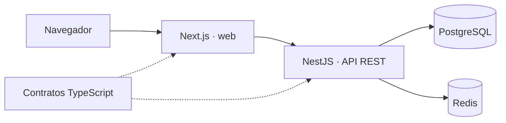
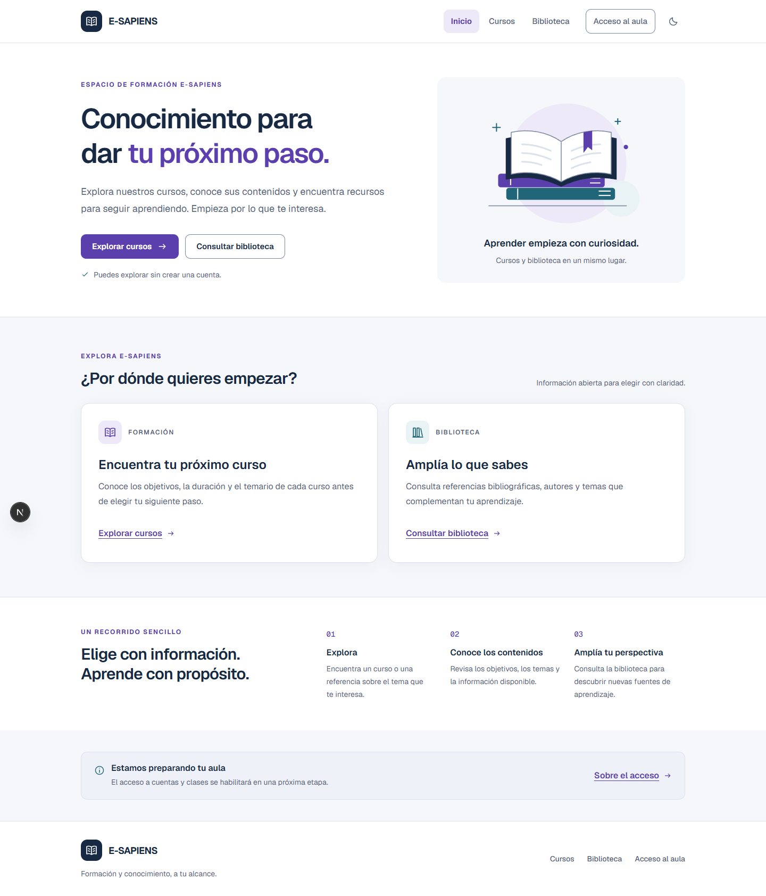
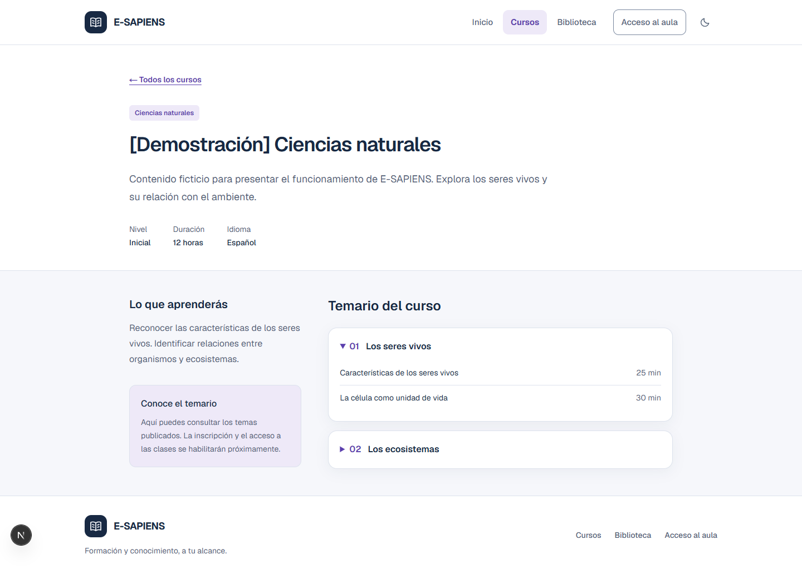

# E-SAPIENS

Plataforma educativa web para consultar materias y bibliografía, gestionar cuentas e inscripciones, organizar la docencia y acompañar el progreso de los estudiantes. Proyecto académico de Tecnologías Web II, organizado como monorepo TypeScript con frontend y API independientes.

Este README concentra la instalación, arquitectura, operación, demostración y mantenimiento del proyecto. La rama de integración es [`develop`](https://github.com/KevinTapiaAli/E-SAPIENS/tree/develop).

## Contenido

- [Funciones por perfil](#funciones-por-perfil)
- [Tecnologías y decisiones](#tecnologías-y-decisiones)
- [Estructura del código](#estructura-del-código)
- [Instalación en otra computadora](#instalación-en-otra-computadora)
- [Recorrido para revisar el sistema](#recorrido-para-revisar-el-sistema)
- [Configuración](#configuración)
- [Comandos disponibles](#comandos-disponibles)
- [Actualizar después de un cambio](#actualizar-después-de-un-cambio)
- [Base de datos y seguridad](#base-de-datos-y-seguridad)
- [Indicadores ejecutivos](#indicadores-ejecutivos)
- [Capturas de ejecución](#capturas-de-ejecución)
- [Problemas frecuentes](#problemas-frecuentes)
- [Calidad y alcance](#calidad-y-alcance)

## Funciones por perfil

| Perfil         | Funciones implementadas                                                                                                                                   |
| -------------- | --------------------------------------------------------------------------------------------------------------------------------------------------------- |
| Visitante      | Inicio institucional, muestra de materias publicadas, catálogo con búsqueda y paginación, temarios, fichas bibliográficas y solicitud de cuenta.          |
| Estudiante     | Materias inscritas, solicitudes de inscripción, lecciones autorizadas, avance, materiales, tareas, entregas, cárdex y calendario personal.                |
| Docente        | Materias asignadas, materiales, tareas, revisión de entregas, calificaciones, solicitudes de inscripción y seguimiento de estudiantes.                    |
| Administración | Panel ejecutivo, gestión de personas y materias, revisión de formación docente, asignaciones, matrículas, autorizaciones por módulo y análisis académico. |

Los tres espacios comparten navegación con búsqueda, accesos móviles, ayuda contextual, preferencias y calendario lateral. La agenda permanece cerrada hasta abrirla, permite cambiar de mes y muestra próximos pendientes. El carrusel institucional cambia cada cinco segundos y ofrece controles de pausa. Las opciones visibles dependen de los permisos; la API vuelve a comprobar la autorización en cada operación.

## Tecnologías y decisiones

Las versiones exactas de dependencias están fijadas en `pnpm-lock.yaml`; no es necesario instalar NestJS ni Next.js globalmente.

| Tecnología                                 | Uso y motivo                                                                                                                                      |
| ------------------------------------------ | ------------------------------------------------------------------------------------------------------------------------------------------------- |
| Node.js 24                                 | Entorno común de ejecución; `.node-version` fija la referencia 24.21.0 para desarrollo y CI.                                                      |
| TypeScript                                 | Contratos explícitos y comprobación estática entre capas.                                                                                         |
| Next.js 16 + React 19                      | Renderizado en servidor del catálogo y composición de interfaces privadas; componentes cliente únicamente para interacciones.                     |
| Tailwind CSS 4 + CSS Modules               | Estilos compartidos, temas y componentes aislados sin una biblioteca adicional de interfaz. Las fuentes del sistema evitan descargas al compilar. |
| NestJS 12                                  | API modular con inyección de dependencias, DTO, validación y autorización centralizada.                                                           |
| PostgreSQL 18 + `pg`                       | Integridad relacional, transacciones, funciones de acceso y consultas SQL parametrizadas. Se conserva el modelo SQL sin añadir un ORM.            |
| Redis 7.4                                  | Límites compartidos de autenticación y medición entre instancias. El acceso se bloquea si no puede aplicarse su protección.                       |
| pnpm 10.34.5 + Turborepo                   | Dependencias de workspace, lockfile único y coordinación de tareas de web/API.                                                                    |
| Docker Compose                             | PostgreSQL y Redis reproducibles para desarrollo, con volumen persistente y comprobaciones de disponibilidad.                                     |
| OpenAPI / Swagger                          | Documentación interactiva generada desde la API.                                                                                                  |
| Argon2id, Helmet y Pino                    | Hash de contraseñas, cabeceras de protección y registros estructurados con ocultación de secretos.                                                |
| Jest, Supertest, ESLint, Oxlint y Prettier | Infraestructura de calidad y estilo del repositorio. GitHub Actions ejecuta el flujo de integración.                                              |

Se utiliza un **monolito modular**, sin microservicios ni paquetes vacíos. Next.js presenta información y actúa como proxy web; NestJS es la autoridad de negocio. Esta separación permite ampliar cada dominio y escalar instancias manteniendo autorización, datos y límites compartidos.



## Estructura del código

```text
apps/
  web/src/
    app/                 Rutas públicas, portales y proxies de Next.js
    features/            Catálogo, autenticación, aula, docencia y analítica
    shared/              Componentes visuales y clientes HTTP
  api/src/
    modules/             Identidad, académico, catálogo, biblioteca y analítica
    infrastructure/      Conexiones con PostgreSQL y Redis
    common/              Validación HTTP y tratamiento de errores
    cli/                 Creación autorizada de cuentas
  api/test/              Pruebas de integración
packages/contracts/      Tipos compartidos entre web y API
database/
  migrations/            Esquema inicial y migraciones incrementales
  seeds/                 Contenido ficticio opcional para demostración
scripts/                 Preparación local, migraciones y retención analítica
assets/screenshots/      Capturas históricas incorporadas a este README
.github/workflows/       Integración continua
```

Las lecturas privadas no se almacenan en cachés públicas. Las consultas se paginan y utilizan conexiones acotadas. La agenda y las actividades complementarias cargan a demanda. La muestra de cursos de la portada utiliza la misma API y tarjetas que el catálogo, con un máximo de tres materias y estados diferenciados para carga, ausencia de datos y servicio no disponible.

## Instalación en otra computadora

### 1. Requisitos

- Git.
- Node.js **24.21.0**, conforme a `.node-version`.
- Docker Desktop iniciado, con motor de contenedores Linux listo. En Windows, habilitar su integración con WSL 2.
- Internet durante la descarga inicial del repositorio, dependencias e imágenes Docker.
- Puertos locales 3000, 4000, 5433 y 6379 disponibles.

Los ejemplos usan PowerShell. El sufijo `.cmd` evita el bloqueo de `pnpm.ps1` sin cambiar la política de ejecución. En Linux/macOS usar `pnpm` en lugar de `pnpm.cmd`.

```powershell
npm.cmd install --global pnpm@10.34.5
git clone --branch develop https://github.com/KevinTapiaAli/E-SAPIENS.git
Set-Location E-SAPIENS
pnpm.cmd install --frozen-lockfile
```

Ejecutar los comandos uno por uno. Si alguno falla, corregirlo antes de continuar. La raíz correcta contiene `package.json` y `pnpm-workspace.yaml`. No clonar encima de otra copia. Si el repositorio es privado, el propietario debe conceder acceso al ingeniero en GitHub.

### 2. Preparar la demostración

Con Docker Desktop abierto:

```powershell
pnpm.cmd setup:demo
```

Este comando crea `.env` y `apps/web/.env.local` desde sus plantillas **solo si faltan**, inicia PostgreSQL/Redis, prepara el esquema, aplica migraciones y añade tres materias, dos fichas bibliográficas y lecturas de demostración. Termina sin iniciar la web. Los datos están identificados como ficticios y no sustituyen registros existentes.

La preparación normal `pnpm.cmd dev` no añade contenido de demostración automáticamente. Para que un clon nuevo muestre materias desde el comienzo, realizar `setup:demo` antes del recorrido académico.

### 3. Crear las cuentas de revisión

En la misma terminal:

```powershell
pnpm.cmd account:create administrador_general
pnpm.cmd account:create docente
pnpm.cmd account:create estudiante
```

Cada comando solicita correo, nombres, apellidos y una contraseña confirmada de **15 a 128 caracteres**, con entrada oculta. El docente también necesita especialidad. Elegir correos distintos y recordar las credenciales creadas. No existen contraseñas predeterminadas ni cuentas de acceso compartidas dentro del código.

Estas cuentas quedan aprobadas. La CLI no asigna automáticamente materias o matrículas. Si una cuenta ya existe, el comando la conserva y rechaza la duplicación. El registro público crea estudiantes pendientes de aprobación administrativa.

### 4. Iniciar

```powershell
pnpm.cmd dev
```

El comando prepara infraestructura y migraciones antes de iniciar Next.js y NestJS. **Mantener esta terminal abierta** y esperar a que Next.js indique que está listo y NestJS muestre `E-SAPIENS API running on http://localhost:4000/api/v1`. Que aparezca el formulario de acceso no significa que la API haya terminado de arrancar.

| Servicio                            | Dirección                                 |
| ----------------------------------- | ----------------------------------------- |
| Web e inicio                        | http://localhost:3000                     |
| Acceso único de los tres perfiles   | http://localhost:3000/login               |
| Catálogo                            | http://localhost:3000/cursos              |
| Biblioteca                          | http://localhost:3000/biblioteca          |
| Swagger                             | http://localhost:4000/api/docs            |
| Disponibilidad de API, base y Redis | http://localhost:4000/api/v1/health/ready |

Para detener web y API, usar `Ctrl+C`. Para detener los contenedores conservando los datos:

```powershell
docker compose -f docker-compose.dev.yml stop
```

No eliminar los volúmenes de Docker para actualizar. En los siguientes arranques basta con abrir Docker Desktop y ejecutar `pnpm.cmd dev`.

## Recorrido para revisar el sistema

Usar ventanas privadas o cerrar la sesión antes de cambiar de usuario. No se elige un rol en el formulario: los permisos de la cuenta determinan el portal.

1. **Visitante:** abrir el inicio, consultar las tres materias de demostración, acceder a un temario y buscar fichas en la biblioteca. Si se omite el seed, el catálogo puede estar vacío; solo aparecen cursos publicados.
2. **Administrador:** entrar con la cuenta creada. En **Docentes y asignaciones**, registrar la revisión de formación del docente y guardar. Asignarle una materia, confirmar su idoneidad y escribir el motivo. La revisión de formación es un requisito de la asignación.
3. **Estudiante:** entrar y solicitar esa materia desde **Inscribirme**. La aprobación de la cuenta y la aprobación de la inscripción son procesos distintos.
4. **Docente:** abrir sus solicitudes y aprobar la inscripción. Luego abrir su materia para gestionar materiales y crear una tarea con plazo futuro.
5. **Administrador:** en **Matrículas y acceso**, abrir la matrícula del estudiante y autorizar los módulos correspondientes con fechas vigentes y motivo. Una matrícula activa no sustituye la autorización de los módulos. También puede registrar una matrícula directamente desde esta sección.
6. **Estudiante:** abrir la materia, consultar una lección autorizada, registrar su avance y revisar/entregar la tarea. Los módulos progresivos pueden requerir completar primero las lecciones anteriores.
7. **Docente:** revisar la entrega y registrar calificación/retroalimentación. Consultar el seguimiento de estudiantes.
8. **Cada perfil:** abrir el calendario lateral, desplazarse entre meses y crear un recordatorio futuro. Los avisos de la agenda no son correos ni notificaciones push.
9. **Administrador:** revisar el panel ejecutivo y los informes académicos. Los indicadores reflejan datos locales reales; no se generan visitas ni actividad artificiales para rellenar gráficos.

## Configuración

| Variable       | Valor local de referencia             | Uso                                                       |
| -------------- | ------------------------------------- | --------------------------------------------------------- |
| `APP_ENV`      | `local`                               | Restringe las herramientas de preparación y demo.         |
| `NODE_ENV`     | `development`                         | Modo de ejecución local.                                  |
| `APP_URL`      | `http://localhost:3000`               | Origen permitido y configuración de cookies.              |
| `API_URL`      | `http://localhost:4000`               | Dirección de NestJS utilizada por Next.js en el servidor. |
| `DATABASE_URL` | Plantilla `.env.example`, puerto 5433 | Conexión privada con PostgreSQL.                          |
| `REDIS_URL`    | `redis://localhost:6379`              | Servicio de límites de acceso.                            |

Las plantillas incluyen las credenciales **exclusivamente locales** de Docker. Los archivos `.env`, cookies, contraseñas y copias de la base no se versionan. `apps/web/.env.local`, si contiene `API_URL`, debe coincidir con el backend local. Mantener los puertos predeterminados durante la revisión; cambiar puertos exige alinear URLs, procesos y Compose. Abrir la web con el origen configurado, sin alternar `localhost` y `127.0.0.1`.

Los campos de almacenamiento, correo y pagos de la plantilla son reservas de configuración; no se requieren servicios externos para el recorrido descrito. Compartir un enlace de GitHub comparte código, no publica la web en Internet ni sincroniza la base de datos.

## Comandos disponibles

Todos se ejecutan desde la raíz con `pnpm.cmd <comando>`.

| Comando                              | Propósito                                                                     |
| ------------------------------------ | ----------------------------------------------------------------------------- |
| `dev` / `dev:local`                  | Preparar infraestructura y migraciones e iniciar web/API.                     |
| `dev:apps`                           | Iniciar solo web/API cuando la infraestructura ya está preparada.             |
| `setup:demo`                         | Preparar una instalación local con materias, biblioteca y lecturas ficticias. |
| `infra:up`                           | Iniciar PostgreSQL y Redis y esperar su disponibilidad.                       |
| `db:prepare`                         | Crear el esquema si falta y aplicar migraciones pendientes.                   |
| `db:migrate`                         | Aplicar solo migraciones incrementales y verificar sus checksums.             |
| `db:check`                           | Consultar información del esquema local.                                      |
| `db:init`                            | Instalar el esquema inicial únicamente en una base sin esquema `lms`.         |
| `db:seed:demo` / `db:seed:classroom` | Cargar catálogo ficticio / completar sus lecturas vacías.                     |
| `account:create <perfil>`            | Crear una cuenta aprobada mediante terminal interactiva.                      |
| `analytics:prune`                    | Limpiar medición y atribución antigua en lotes acotados.                      |
| `format:check`, `lint`, `typecheck`  | Comprobar formato, reglas y tipos.                                            |
| `test`, `test:e2e`                   | Ejecutar pruebas automáticas.                                                 |
| `build`                              | Compilar las aplicaciones. No inicia los servidores.                          |

## Actualizar después de un cambio

### En la computadora que recibe los cambios

Detener web/API con `Ctrl+C`. Desde la raíz, comprobar `git status`; guardar cualquier trabajo propio antes de actualizar. Con el árbol limpio:

```powershell
git switch develop
git pull --ff-only origin develop
pnpm.cmd install --frozen-lockfile
pnpm.cmd dev
```

`dev` aplica las migraciones pendientes y conserva los datos. No repetir `db:init`, borrar volúmenes ni reemplazar `.env`. Si es un clon nuevo para la demostración, seguir primero la instalación completa y crear sus cuentas locales.

### Al desarrollar una modificación

```powershell
git switch develop
git pull --ff-only origin develop
git switch -c feat/nombre-del-cambio
```

Modificar el dominio correspondiente, mantener contratos y autorización en la API y crear una migración nueva si cambia el esquema. Conservar las migraciones ya aplicadas. Actualizar este README si cambian requisitos o funcionamiento.

Guardar los archivos pertinentes en un commit y subir la rama:

```powershell
git add <archivos-del-cambio>
git commit -m "feat: describir el cambio"
git push -u origin feat/nombre-del-cambio
```

Abrir un pull request hacia `develop` con descripción del comportamiento, migraciones y validación. GitHub exige `Quality Gate` para integrar; no forzar la subida ni desactivar la protección. Cuando el PR esté integrado, las demás computadoras reciben el cambio con el procedimiento anterior. El historial de Git permite recuperar versiones anteriores sin conservar reportes duplicados en el árbol del proyecto.

## Base de datos y seguridad

- El esquema inicial y las migraciones incrementales son la fuente de verdad. Se registran checksums y se utilizan bloqueos para evitar aplicar migraciones simultáneamente.
- El seed es opcional, acotado a local/test y repetible. No borra cursos ni modifica contraseñas existentes. PostgreSQL persiste en el volumen de Compose.
- La API usa consultas parametrizadas, transacciones y validación de DTO. Los cambios sensibles conservan responsable y motivo cuando corresponde.
- La autorización combina rol, permiso, estado de la cuenta y relación con el recurso: asignación docente, matrícula, vigencia y módulos autorizados. Ocultar enlaces no concede ni revoca acceso.
- Las contraseñas nuevas usan Argon2id; los hashes bcrypt existentes se actualizan al iniciar sesión correctamente. No se guardan contraseñas en texto plano.
- Las sesiones son opacas, revocables, de ocho horas. La base almacena el hash del token; las cookies son `HttpOnly`, `SameSite=Lax` y `Secure` con HTTPS.
- Se comprueban el origen de las operaciones, el tamaño y formato del cuerpo, y los límites de autenticación en Redis. Si Redis falla, no se omite esa protección.
- Los registros ocultan cookies y credenciales. La referencia `X-Request-Id` ayuda a investigar incidentes de acceso sin compartir una contraseña.
- No publicar vulnerabilidades, claves, contraseñas ni datos personales en issues públicas. Comunicar incidentes privadamente al responsable del repositorio.

Para producción se necesita HTTPS, secretos propios, base y Redis privados, backups con restauración comprobada, supervisión y un despliegue separado del entorno de demostración. No exponer los contenedores de desarrollo como infraestructura pública. Las características de producción pendientes se enumeran al final.

## Indicadores ejecutivos

El administrador puede consultar visitantes únicos estimados, materias consultadas, conversiones a solicitudes de cuenta e inscripción, estudiantes activos semanalmente e inactivos, solicitudes pendientes y prioridades académicas.

- Tráfico: períodos de 7, 30 o 90 **días UTC completos**. Las visitas de hoy aparecen en el siguiente período cerrado; no se reconstruye tráfico anterior a la activación.
- Visitantes: aproximación por identificador propio del navegador. Cambiar de dispositivo o borrar cookies puede contar otra visita; no equivale a personas identificadas.
- Conversión: visitantes de la cohorte con solicitud atribuida respecto de los visitantes elegibles del período. No todas las cuentas existentes proceden del catálogo medido.
- Actividad semanal: acciones académicas registradas; iniciar sesión por sí solo no equivale a estudiar. La inactividad se basa en ausencia de actividad académica durante al menos 14 días considerando la matrícula.
- La medición respeta exclusión voluntaria y señales DNT/GPC. No envía estos eventos a un proveedor externo.
- `analytics:prune` elimina datos de medición y atribución anteriores a 190 días en lotes de hasta 10 000 por tabla. En un despliegue debe programarse y atender posibles lotes acumulados; no existe un cron automático dentro de la aplicación.

## Capturas de ejecución

Capturas históricas existentes del catálogo público, correspondientes al 03/10/2026. Ilustran una ejecución anterior; algunos textos y elementos han evolucionado y **no acreditan una nueva ejecución de la versión actual**. No se incluyen imágenes simuladas ni capturas con credenciales.

### Inicio público



### Materia de demostración y temario



## Problemas frecuentes

| Situación                                     | Solución                                                                                                                                                                                                                  |
| --------------------------------------------- | ------------------------------------------------------------------------------------------------------------------------------------------------------------------------------------------------------------------------- |
| `ERR_PNPM_NO_IMPORTER_MANIFEST_FOUND`         | Entrar en la carpeta con `package.json`. Si se está en una carpeta exterior, ejecutar `Set-Location .\E-SAPIENS`.                                                                                                         |
| `db:migrate` no se reconoce                   | Usar `pnpm.cmd db:migrate`; es un script del proyecto, no un comando de PowerShell.                                                                                                                                       |
| `pnpm.ps1` bloqueado                          | Usar `pnpm.cmd`.                                                                                                                                                                                                          |
| Docker no responde                            | Abrir Docker Desktop, esperar al motor Linux y volver a ejecutar el comando fallido.                                                                                                                                      |
| Servicio de acceso no disponible              | Esperar a que la API termine de iniciar. Usar `pnpm.cmd dev` desde la raíz, no solo el frontend. Revisar el error de la terminal y las URLs. La referencia mostrada permite correlacionar el incidente con los registros. |
| `IDENTITY_GATEWAY_UNAVAILABLE`                | La comunicación del proxy con la API falló. Revisar proceso de API, dirección y puerto; no cambiar contraseñas para resolver un fallo de transporte.                                                                      |
| `IDENTITY_UNAVAILABLE` en la API              | Redis no pudo aplicar el límite de acceso. Resolver disponibilidad/configuración de Redis sin desactivar la protección.                                                                                                   |
| Origen no permitido                           | Abrir exactamente `APP_URL`; no alternar host, protocolo o puerto.                                                                                                                                                        |
| La portada o el catálogo no muestran materias | En una instalación de demostración ejecutar `setup:demo`; en datos propios publicar la materia desde Administración. Un error de servicio requiere revisar la API, no volver a cargar datos.                              |
| Docente sin cursos                            | Registrar su revisión de formación y asignarle una materia desde Administración.                                                                                                                                          |
| Estudiante sin acceso a una lección           | Revisar aprobación, matrícula activa, autorizaciones de módulos, fechas y requisitos progresivos.                                                                                                                         |
| Cuenta ya existente                           | Usar las credenciales de esa instalación; la CLI no sobrescribe cuentas. GitHub no transporta cuentas entre equipos.                                                                                                      |
| Puerto ocupado                                | Detener la instancia anterior desde su terminal. No iniciar varias copias en los mismos puertos.                                                                                                                          |
| Git no puede actualizar con `--ff-only`       | Hay cambios o ramas divergentes: conservar el trabajo y resolver la integración; no usar `reset --hard` ni push forzado.                                                                                                  |

## Calidad y alcance

La automatización de GitHub Actions instala dependencias con el lockfile, prepara PostgreSQL/Redis y ejecuta formato, lint, comprobación de tipos, pruebas y build. El resultado de cada ejecución está en la pestaña **Actions** y en el pull request correspondiente. Pasar CI no sustituye el recorrido funcional del revisor ni pruebas de carga.

La preparación de esta entrega se realizó mediante cambios y lectura de código, sin iniciar la web, recorrer pantallas ni ejecutar pruebas locales. Las capturas anteriores se conservan con su fecha. No se garantiza ausencia absoluta de errores: el ingeniero puede reproducir la instalación y el recorrido de este README y consultar los resultados asociados al commit recibido.

El alcance implementado es la plataforma web descrita. Recuperación/verificación por correo, pagos, certificados, exámenes completos, distribución privada de video, mensajería externa y aplicación móvil requieren desarrollo e integración adicionales. Tener tablas o variables reservadas para esos dominios no significa que estén operativos. No se requiere contratarlos para revisar el sistema académico actual.
